## Conheça as novidades desta versão:

[Depurador
(Debug)](ReleaseNote#depurador)

[Profiler](ReleaseNote#profiler)

[Atualização
do Axis para consumo de Webservice padrão SOAP 1.2](ReleaseNote#atualizacao_do_axis_para_consumo_de_webservice_padrao_soap_)

[Integração
do Webrun com videoconferência (Softwell Média Server)](ReleaseNote#integracao_do_webrun_com_videoconferencia)

[37
Funções Novas mais diversas correções](ReleaseNote#novas_funcoes)

[Remoção
de campos através do assistente de criação de tabelas](ReleaseNote#remocao_de_campos_atraves_do_assistente)

[Melhoria
na performance de leitura/gravação no banco de dados da IDE](ReleaseNote#melhoria_na_performance_de_leitura_gravaca_no_banco)

[Otimização
do processo de gravação nos formulários](ReleaseNote#otimizacao_do_processo_de_gravacao_nos_formularios)

[Diretório
das comunidades Maker integradas na IDE](ReleaseNote#diretorio_das_comunidades_maker_integradas)

[Melhorias
na interface do editor de fluxos](ReleaseNote#melhorias_na_interface_do_editor_de_fluxos)

[Salva
a posição e tamanho do montador de expressão, e permitir que a lista de
função sejam unida (dock) ao editor](ReleaseNote#salva_a_posicao_e_tamanho_do_montador_de_expressao)

[Melhoria
dos componentes SUBFLUXO e INTERAÇÃO para permitir uma rápida definição
dos parâmetros](ReleaseNote#melhorias_dos_componentes_subfluxo_e_interacao_)

[Identificação
visual do SIM/NÃO da decisão, independente da descrição](ReleaseNote#indentificacao_visual_sim_ou_nao)

[Opção
"Obter Metadados extendidos do banco"](ReleaseNote#opcao_obter_metadados_extendidos_do_banco)

[Facilidade
de associação de fluxograma a evento](ReleaseNote#facilidade_de_associacao_de_fluxograma_a_evento)

[Ícone
de acesso rápido a um fluxo associado a um evento](ReleaseNote#icone_de_acesso_rapido_a_um_fluxo)

## Depurador

O novo Depurador tem como função detectar erros na construção
de um fluxograma, rastreando todos os objetos (processamentos, decisões,
subfluxos e interações) presentes na regra executada.

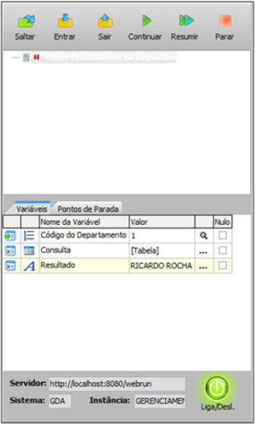

## Profiler

O Profiler é um utilitário estatístico para avaliação das
regras associadas a um sistema, que foram configuradas para serem executadas
na camada Servidor. Ele identifica possíveis gargalos e evita
que o produto final chegue até ao cliente com pouco desempenho.

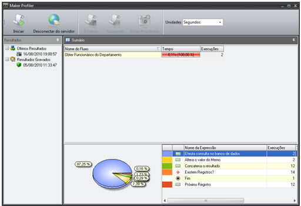

## Novas Funções

1. Obter Total de Linhas do Arquivo
2. Manter Cursores Após Commit
3. Associar Evento à Aba
4. Existe Componente?
5. Inserir Texto na Posição do Cursor no Texto Rico
6. Inserir texto na posição do cursor no Memo
7. Monitorar Posição do Cursor no Texto Rico
8. Monitorar posição do cursor no Memo
9. Moldura - Habilitar com componentes internos
10. Moldura - Mostrar com componentes internos
11. Moldura - Mover com componentes internos
12. Executar Fluxo no Formulário numa Moldura
13. Obter valor do componente do formulário da moldura
14. Grade - Checkbox Marcar Todos
15. Grade - Mostrar barra de edição
16. Tabela - Alterar folha de estilo do elemento
17. Tabela - Associar Evento a Linha ou Célula
18. Abrir ActiveX numa moldura
19. CSS - Importar conteúdo da folha de estilo
20. CSS - Importar folha de estilo
21. Logger - Adicionar Mensagem
22. Obter Pilha do Erro
23. Obter versão do Webrun
24. Diretório de arquivos de configuração
25. Upload Múltiplos arquivos
26. Lista Dinâmica - Definir Tipo
27. Email - Email do remetente da mensagem
28. Agendar Execução de Fluxo sem Pai
29. Remover vínculo de parentesco entre fomrulários
30. Obter Caminho do WFRE
31. Chamar Serviço Web (SOAP1.2)
32. Chamar Serviço Web (SOAP1.2) - Certificado Digital
33. Obter String Biométrica
34. Áudio/Vídeo Conferência - Enviar Stream de Webcam
35. Áudio/Vídeo Conferência - Fechar Stream
36. Áudio/Vídeo Conferência - Receber Stream
37. Enviar Envelope Soap

## Remoção de campos através do assistente de criação de tabelas.

Ao remover um componente da tela, caso o mesmo esteja ligado a um campo
do banco de dados, será aberto o Assistente de Criação de Tabelas, perguntando
se deseja remover este campo da tabela.

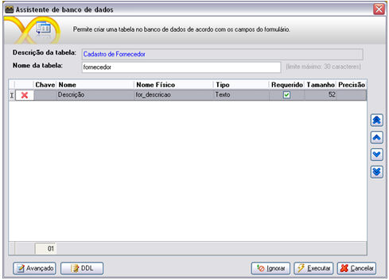

As colunas presentes nesta tela são:

- Chave: Indica se o campo é chave primária da tabela
- Nome: Descritivo do campo no dicionário de dados
- Nome Físico: Nome real da tabela no banco de dados
- Tipo: Tipo do campo
- Requerido: indica se o campo é obrigatório ou não.
- Tamanho: Tamanho do campo
- Precisão: Para campos fracionados, indica a precisão do campo

Observação: Caso o campo seja uma chave estrangeira, este não poderá
ser removida, a menos que a chave estrangeira seja apagada antes do banco
de dados.

## Melhoria na performance de leitura/gravação no banco de dados da IDE

Pode ser selecionado onde será guardado o cache dos metadados na opção
"Nível do Cache" da tela de Configurações:

- Em memória: Na memória RAM.
- Persistente: Em disco.

Para reinicializar o cache, tecle F5. Sempre que o Maker for fechado,
o cache será removido.

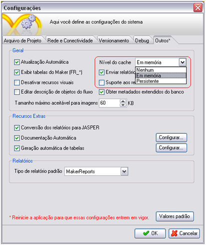

## Otimização do processo de gravação nos formulários

O processo de salvar os formulários se tornou visivelmente mais rápido

## Diretório das comunidades Maker integradas na IDE

Link direto para as principais comunidades Maker na Web. É acessada
através do menu "Ajuda".

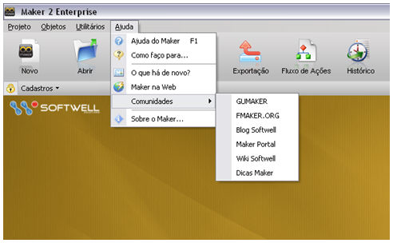

## Melhorias na interface do editor de fluxos

Busca mais inteligente na lista de fluxo e funções, agora a descrição
é levada em consideração na pesquisa.

## Salvar a posição e tamanho do montador de expressão, e permitir que a lista de função sejam unidas (dock) ao editor

É possível alterar o tamanho da tela do montador de expressão, personalizando
o tamanho ao gosto do usuário, permitindo também anexar a janela de Propriedades
no Montador de Expressão através do botão "Anexar Janela/Janela Flutuante".

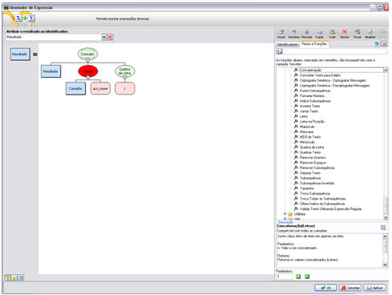

## Melhoria dos componentes SUBFLUXO e INTERAÇÃO para permitir uma rápida definição dos parâmetros

Agora é possível atribuir o valor dos parâmetros de subfluxos e interações
diretamente, sem a necessidade de abrir o Montador de Expressão, com a
identificação imediata do tipo passado, caso seja digitado um texto o
valor do parâmetro será automaticamente do tipo Letras, caso seja digitado
um valor fracionado ele será automaticamente do tipo Fracionado. Um ícone
indica o tipo do valor digitado. Para passagens de parâmetros personalizadas,
há a opção de abrir o Montador de Expressão.

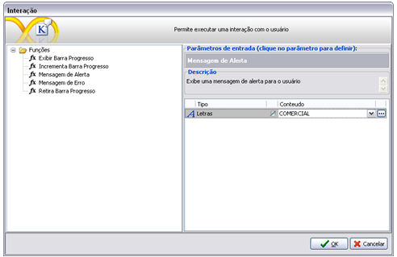

## Identificação visual do SIM/NÃO da decisão, independente da descrição

Há uma identificação para cada saída de uma decisão, a saída SIM possui
cor verde e a saída NÃO possui cor vermelha

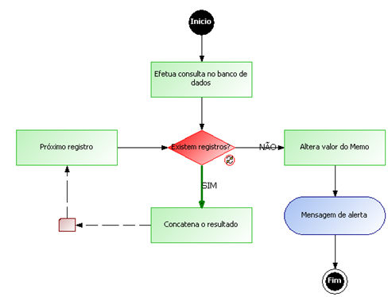

**Figura:
Sim**

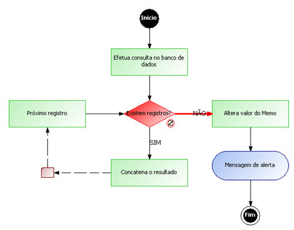

**Figura:
Não**

## Opção "Obter Metadados extendidos do banco"

Na tela de configurações há esta nova opção que permite uma melhor performance
na leitura dos dados do banco, no entanto, as chaves primárias e os tipos
dos campos não são destacadas nos resultados das consultas.

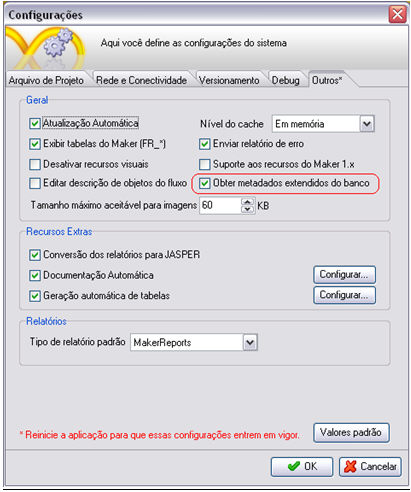

## Facilidade de associação de um fluxograma a um evento

É possível selecionar um fluxo e arrastá-lo até um componente do formulário,
ou ao próprio formulário, serão listados os eventos disponíveis pelo objeto
para a associação do fluxograma.

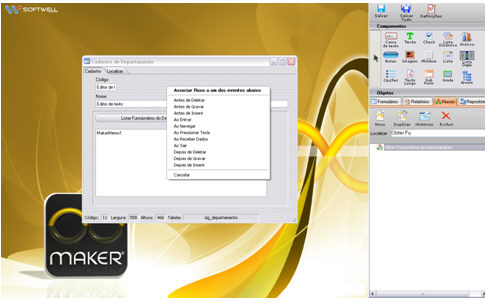

## Ícone de acesso rápido a um fluxo associado a um evento

Ao lado do nome do evento há um ícone que permite abrir o fluxo associado.
Caso não haja nenhum fluxo associado ao evento desejado, ao clicar neste
botão o Editor de Fluxos e Ações será aberto, ao salvar este fluxo ele
será associado ao evento selecionado anteriormente.

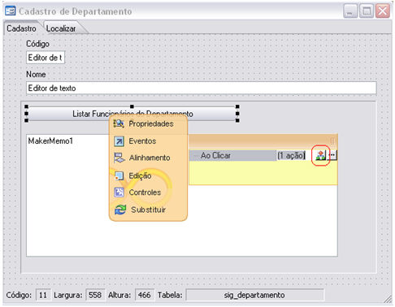

## Atualização de biblioteca para consumo de Webservices padrão SOAP 1.2

O Webrun 2.6 contém a biblioteca Axis 2.0 para suportar esta nova funcionalidade.
Foram liberadas duas novas funções para consumir  Webservice neste
padrão (SOAP 1.2).

Funções:

- Chamar Serviço Web (SOAP1.2)
- Chamar Serviço Web (SOAP1.2) - Certificado Digital

O padrão SOAP 1.2 será obrigatório para utilização da Nota Fiscal Eletrônica
2.0.

## Integração do Webrun com videoconferência (Softwell Media Server)

Agora é possível fazer Vídeoconferência utilizando o Webrun.

Estão disponíveis três novas funções para comunicação com o servidor
de stream.

- Áudio/Vídeo Conferência  - Enviar Stream
  de Webcam
- Áudio/Vídeo Conferência - Receber Stream
- Áudio/Vídeo Conferência - Fechar Stream

As funções mais o servidor de stream (Softwell Média Server) estão disponíveis
no link abaixo:

&lt;http://download.softwell.com.br/VideoConferencia.rar&gt;
