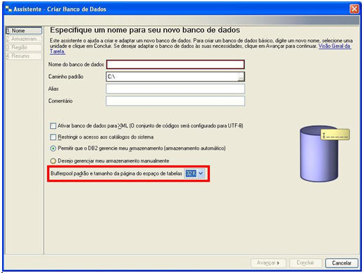
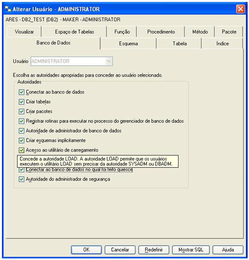

Para que o banco DB2 possa ser utilizado pelo Maker é necessário que
as seguintes configurações estejam aplicadas.

1. O banco deverá ser criado pelo cliente DB2:

1.1. O parâmetro Bufferpool padrão e tamanho da página do espaço de
tabelas deverá ser configurado com 32K.

2. Deverá ser dado permissões ao usuário que irá acessar pelo Maker.

