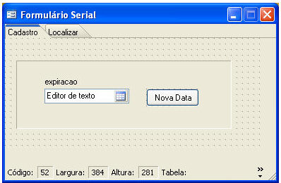
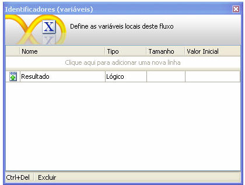
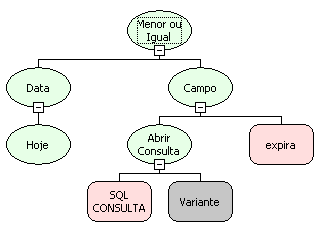
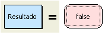

A utilização de um Formulário para Serial permite controlar o direito ao uso de um projeto.

Funções que serão utilizadas:

- Abrir Consulta;
- Campo;
- Executar Atualização;
- Menor ou igual;
- Obter Valor do Componente do Formulário.

Siga os passos:

1. Crie um formulário que servirá para alterar os parâmetros de configuração. Para este caso, será utilizado um campo do tipo Data. Segue abaixo o script da tabela e o layout deste formulário:

create table TabSerial(codigo serial,expira date)

2. Vincule o formulário à propriedade Formulário do Serial: clique com o botão direito do mouse sobre a Área de Trabalho do Maker e selecione a Propriedade contida no menu pop-up .
3. Crie um fluxo para Verificar Serial;

1. Variável local - resultado, armazena o valor de retorno ao Webrun:

2. Fluxo tipo Servidor:

3. Decisão: Data Atual&lt;= Data de Expiração?

4. Caso a data seja válida:Resultado:=True;

5. Caso a data não seja válida:Resultado:=False;

4. Crie o fluxo para alterar o critério.

1. Variável Local Data_Nova: Será o novo critério de expiração do serial.

2. Processamento: Capturar Nova Data.

3. Parâmetro de entrada do SubFluxo: Atualiza Data. A data recebida é oriunda do FORMULARIO SERIAL - Atualiza Data.

4. Fluxo Cliente: Atualiza Data:

5. Fluxo Servidor: Atualiza Data. Atualiza a data no banco de dados.

6. Processamento: Atualiza Data.

7. Evento: Ao Clicar do Botão Nova Data:

Esse exemplo utiliza, como critério de permissão, um dado do tipo data, mas, no sistema, é possível usar o critério que satisfaça às regras de segurança de seu cliente.

Após ter sido configurado um fluxo de ação para o evento Ao Verificar Serial e definido um formulário para o Formulário do Serial, é necessário clicar no item Salvar do menu Projeto para que as últimas modificações sejam salvas. Em seguida, o sistema deve ser Reiniciado. Posteriormente, assim que o usuário efetuar o login no sistema (Webrun), o Formulário do Serial aparecerá para que o usuário possa informar um novo serial (código de liberação de acesso à aplicação).

Observação: Para este exemplo, execute os seguintes scripts:

- create table TabSerial(codigo serial,expira date);
- insert into tabserial(expira)values('20/08/2008');

O segundo script tem a finalidade de inserir o dado de teste para o exercício.
