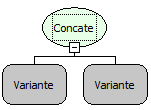

Descrição:

Junta vários
itens de texto em apenas um item.

Parâmetros:

1. Valor a ser
concatenado.

2. Valor a ser
concatenado com o primeiro.

Retorno:

Retorna os valores
concatenados (Letras).

Observação:

A função pode
ter vários parâmetros.

Exemplos:

1. Assumindo
os parâmetros como 'Maker'(Letras) e 'Flow'(Letras), o retorno seria 'Maker
Flow'.

2. Assumindo
os parâmetros como 'Maker'(Letras) e 3(inteiro), o retorno seria 'Maker3'.

Nome
Real:

sqlConcat

Compatibilidade:

Todas as camadas
