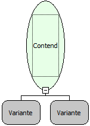

Descrição:

Essa Função
é utilizada após a cláusula where em uma estrutura select ou update. Verifica
se o elemento trazido pelo parâmetro está
contido no contexto do select ou update.

Parâmetros:

Nome
Real:

sqlContaining

Compatibilidade:

Todas as camadas
