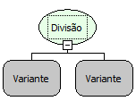

Descrição:

Essa função
é utilizada para fazer a divisão.

Parâmetros:

1. Informar
o valor do dividendo.

2. Informar
o valor do divisor.

Retorno:

Resultado da divisão dos números
passados por parâmetros.

Observações:

1. Não funciona
no evento ao entrar e ao sair no componente grade em tipo servidor e cliente;

2. Não funciona
no componente imagem em tipo cliente servidor e cliente;

3. Não funciona
no evento ao sair no formulário em tipo servidor e cliente;

4. Não funciona
no evento ao preencher a lista no componente lista dinâmica em tipo cliente
e servidor;

5. Essa função
aceita só dois parâmetros.

Exemplo:

Assumindo os
parâmetros como: 10 (Inteiro), 5 (Inteiro), o retorno seria : 2,0 (Fracionado).

Nome
Real:

sqlDivide

Compatibilidade:

Todas as camadas
