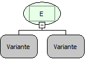

Descrição:

Essa função
verifica se algum valor passado é falso, para retorna falso ou se são
verdadeiros para retornar verdadeiro.

Parâmetros:

1. Recebe valores
ou funções que retornem valores lógicos.

Retorno:

Retorna verdadeiro
se todos os valores forem verdadeiros, caso um valor seja falso o retorno
será falso.

Observação:

Essa função
pode conter (n) parâmetros.

Exemplos:

1. Assumindo
que tenhamos dois parâmetros: o 1º recebe a função maior contendo os parâmetros:
3 e 5 (3&gt;5) e o 2º recebe a função menor contendo os parâmetros: 7
e 10 (7&lt;10), o retorno será falso,pois 3 é menor que 5.

2. Assumindo
que tenhamos dois parâmetros: o 1º recebe a função igual contendo os parâmetros:
A e A (A=A) e o 2º recebe a função diferente contendo os parâmetros: 56
e 65 (56&lt;&gt;65), o retorno será verdadeiro, pois as duas condições
são verdadeiras.

Nome
Real:

sqlAnd

Compatibilidade:

Todas as camadas
