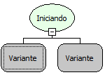

Descrição:

Essa Função
é utilizada após a cláusula where em uma estrutura select ou update. Verifica
se o elemento trazido pelo parâmetro está sendo iniciado no contexto do
select ou update.

Parâmetros:

1. Conteúdo
que será verificado

2. A cláusula
que se baseará o filtro

Retorno:

Conteúdo filtrado
(Variante)

Nome
Real:

sqlStarting

Compatibilidade:

Todas as camadas
