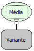

Descrição:

Retorna a média, a partir dos
valores contidos no campo.

Parâmetros:

1. Campo que será calculado
a média

Retorno:

Média do campo informado como
parâmetro (variante)

Nome
Real:

sqlAvg

Compatibilidade:

Todas as camadas
