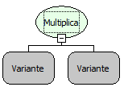

Descrição:

Retorna a multiplicação
dos números passados por parâmetro.

Parâmetros:

1. Valor a ser
multiplicado.

2. Valor a ser
multiplicado pelo 1° parâmetro.

Retorno:

Resultado da
multiplicação dos parâmetros passados.

Observação:

Essa função
aceita mais de dois parâmetros.

Exemplo:

Assumimos os
valores dos parâmetros 5 (Inteiro) e 4 (Inteiro), o retorno seria 20 (Inteiro).
