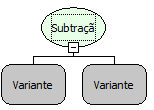

Descrição:

Subtração de valores informados
nos parâmetros.

Parâmetros:

1. Informar o valor para a subtração.

2. Informar o valor para fazer
a subtração com o 1° parâmetro.

Retorno:

Retorna a subtração de dois
ou mais números.

Observação:

Esta função pode conter mais
de dois parâmetros.

Exemplo:

Assumindo os
parâmetros como: 10 (Inteiro) e 5 (Inteiro), o retorno seria: 5(Inteiro).

Nome
Real:

sqlSubtract

Compatibilidade:

Todas as camadas
