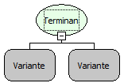

Descrição:

Função utilizada
após a cláusula where em uma estrutura select ou update.

Parâmetros:

1. Campo.

2. Valor.

Retorno:

Resultado( Variante).

Nome
Real:

sqlEnding

Compatibilidade:

Todas as camadas.
