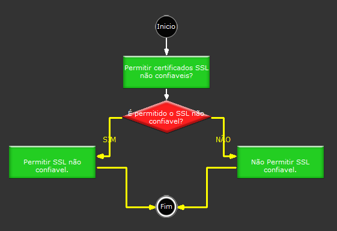

# Permitir Certificados SSL Não Confiáfeis

Descrição:

Faz a aplicação aceitar ou não certificados SSL inválidos.

Parâmetros:

1. Verdadeiro para aceitar certificados inválidos. Caso contrário, Falso.

Retorno:

Não possui.

Observação:

Por padrão o Webrun é pre configurado para aceitar SSL's Inválidos "Vencidos".

Exemplo:

Ao entrar no sistema utilize a função assumindo o parâmetro como "falso", em um formulário utilize

a função "Obter conteúdo da URL". Caso a URL informada estaja com SSL inválido ou vencido o conteúdo

não será acessado e uma janela de erro será apresentada.

Nome Real:

ebfSSLAccept

Compatibilidade:

Servidor
