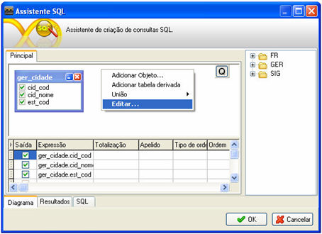
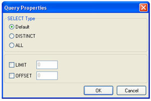
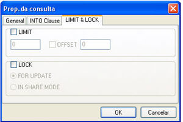

As funções LIMIT e OFFSET, funcionam no Maker para os tipos de bancos de dados MySql e Postgres.

Com um formulário aberto, clique em , em seguida .

Com a tela Assistente SQL aberta, clique com o botão direito do mouse na área da aba Principal: e selecione a opção Editar... do menu pop-up:

A função LIMIT tem como funcionalidade limitar a quantidade de registros trazidos pelo banco, e a função OFFSET  define a posição inicial  da lista.

Exemplo: Se LIMIT = 2 e OFFSET = 6, isto quer dizer que será mostrado dois registros após o 6 registro, ou seja, trará os registros da posição 7 e 8.

Se o tipo do banco de dados for MySQL, a tela será assim:

