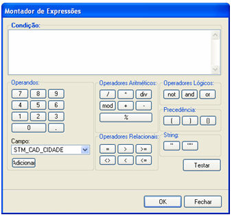

Esse Montador de Expressão é característica da [Propriedade Cor Condicional](maker_2/formulario/propriedades_e_eventos) do componente [Grade](maker_2/formulario/componentes/grade).

É muito utilizado para adicionar cor nos campos da tabela.

A tela é composta por várias áreas:

- Condição - local onde escreve-se a condição para formatação;
- Operadores - utilizado para atribuir valor:

- Campo - permite escolher campos disponíveis na consulta do formulário. Após selecionar o campo, utilize o botão  (adicionar).

Exemplos:

&lt;campo&gt; = &lt;inteiro&gt;

STM_CAD_ID = 1

&lt;campo&gt; = &lt;valor inteiro&gt;

Fun_idade = 18 ou Fun_idade &gt; 18

&lt;campo&gt; = &lt;valor fracionado&gt;

Fun_salario = 3489.90

- Operadores - parte composta pelo teclado numérico e o ponto (observar que utiliza-se o padrão norte americano para separar casas decimais);

- Operadores Aritméticos:

- Botão  - divisão;
- Botão  - multiplicação;
- Botão  - operador para retornar o resultado da divisão de inteiros;
- Botão  - soma;
- Botão  - subtração;

- Botões  - foi depreciado. Utilize o botão , pois a resultado será o resto (módulo) da operação inteira;

- Operadores Relacionais - estes operadores permitem comparar duas ou mais variáveis:

Exemplo:

&lt;campo&gt; = &lt;campo&gt;

Fun_codigo = fun_setor_codigo

&lt;campo&gt; = "&lt;null&gt;"

Fun_tel = ""

Observação: Os tipos dos campos devem ser iguais;

- Operadores Lógicos - composto pelos botões ,  e ;

Exemplo:

&lt;campo&gt;

Fun_ativo

Observação: Adicionar apenas o campo lógico, pois retornará True ou False;

Importante: Para o tipo Lógico (acima citado) é aplicável a partir da Versão Webrun 2.2.0.8m.

- Precedência - botões que são utilizados para separar sentenças (uso de parênteses);

- String - são delimitadores de caracteres;

Exemplo

&lt;campo&gt; = "&lt;String&gt;"

fun_nome = "Machado de Assis"

Importante: Para o tipo String (acima citado) é aplicável a partir da Versão Webrun 2.2.0.8m.

- Botão  - verifica a condição transcrita no local Condição.

- Botão  - confirma a condição criada. Retorna a tela Editor condicional de cores para grade;
- Botão  - fecha a tela Montador de Expressão sem confirmação da condição. Retornando a tela Editor condicional de cores para grade.
