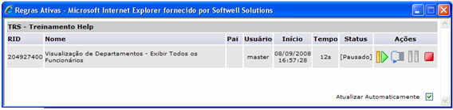
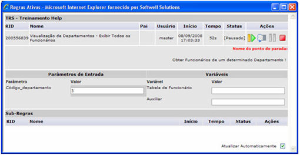

# Depurador (debug)

Por este recurso, podem-se visualizar os fluxos em execução, passo a
passo, no sistema atual. Ele está habilitado para usuários com permissão
de Administrador.

Para acessar este recurso, siga os passos:

1. Com o fluxo aberto no Maker e salvo para depuração, [Acesse
   o Webrun](acessando_webrun);
2. [Acesse um sistema com
   privilégios de administrador](acessando_sistema_webrun);
3. Execute clique duplo no ícone  Depurador
   na área de trabalho do Webrun. Abrirá a tela Regras Ativas.

 - Finalizar regra;

 - Próximo ponto;

 - Pausar regra;

 - Interromper regra.

Caso execute um clique sobre o nome de um dos fluxos, é exibida a mesma
tela com o fluxo selecionado e a opção Atualizar Automaticamente estará
disponível para que o usuário configure a execução: automática ou não.
Com um clique na opção Atualizar, o fluxo é executado independentemente
do tempo-padrão de 5 (cinco) segundos (no modo automático):

Parâmetro de Entrada - Mostra a posição/valor do Código_departamento;

Variáveis - Mostra as duas variáveis que foram criadas no fluxo.

Observações:

- Fluxos criados na camada Cliente, não podem ser depurados;
- Caso haja Subfluxos no fluxo,eles também precisam ser salvos
  para depuração, caso contrário toda a regra não será reconhecida pelo
  Depurador;
- Se utilizar a função Ponto de Parada no fluxo, não é necessário
  selecionar a opção Salvar Para Depuração e os botões 
  (Próximo ponto) e  (Pausar
  regra) funcionarão, porém ao acionados o passo é interrompido na primeira
  passagem da tabela.

Depurador - Esta Vídeo Aula demonstra o uso do Depurador
no Webrun. Este recurso será necessário caso o usuário queira depurar
o fluxo, acompanhando cada etapa da execução da rotina.
