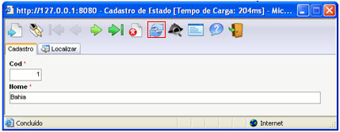

Este recurso, por meio do qual se podem atualizar os objetos do menu
do sistema e atualizar as telas de cadastro (formulários), está habilitado
para usuários com permissão de administrador.

Para acessar este recurso, siga os passos:

1. [Acesse o Webrun](acessando_webrun);
2. Acesse um sistema com privilégios de administrador;
3. Execute clique duplo no botão .

As duas operações básicas que estarão disponíveis são:

-  - atualiza os objetos da Barra
  de Menus do Sistema: dimensões de formulários editados ou formulários
  e relatórios adicionados ou excluídos;
-  Atualiza a estrutura dos formulários
  (botão Atualizar), quando editados pelo Maker:

Observações:

- Caso o usuário não seja administrador, o botão 
  atualizará o conteúdo do registro;
- Passam a fazer parte do arquivo de log gerado pelo servidor
  Web (exemplo: Apache Tomcat) no qual o Webrun está inserido, todas
  as execuções de fluxos de ações que contenham as funções "Abrir
  Consulta" ou "Executar Atualização" quando o Webrun
  estiver em "Modo Projeto". No caso do sistema operacional
  "Windows XP Professional", o arquivo de log fica disponível
  na pasta "C:\Arquivos de programas\Softwell Solutions\Maker 2\Webrun
  2\tomcat\logs".
- A estrutura "C:\Arquivos de programas\Softwell Solutions\Maker
  2" são referentes a instalações feitas a partir do
  Dvd Instalador do Maker 2.4. A estrutura "C:\Arquivos de programas\Softwell
  Solutions\Maker 2.5", referem-se a instalações feitas a partir
  do Dvd Instalador do Maker 2.5.
