## Maker 2.6.1.30

**Problemas corrigidos**:

- Tabelas FR's não são identificadas ao utilizar esquemas no SQL Server.

- Seleção de Conexão adicional não é persistida no Assistente SQL do Editor de Relatórios.
- Sugestão incorreta da propriedade "Descrição" dos componentes na Edição do Formulário.
- Após salvar o relatório e abri-lo novamente, não era possível visualizar a fonte de dados de um componente.
- Fluxo é selecionando automaticamente após salvá-lo e abrir um processamento qualquer.
- Parâmetros de uma consulta SQL não eram persistidos no Editor de Relatórios.
- Lista dinâmica não aplica propriedade "Cor" corretamente ao marcar somente leitura.
- Ao renomear uma consulta no Editor de SQL no RB10, tal ação não era persistida.
- Tabelas que estão fora do esquema principal não são exibidas em projetos com DB2.
- Chave estrangeira não era criada corretamente caso houvesse mais de uma lista dinâmica no formulário.
- Ocorria um erro quando mais de um desenvolvedor tenta salvar um objeto no Maker ao mesmo tempo.
- Componentes retornam cor "Amarela", quando apenas leitura, ao fechar e abrir o formulário.
- Executor de Scripts não executava scripts que continham campos do tipo "TIMESTAMP" no Oracle.
- O Maker está sugerindo o tipo "Date" na criação de tabelas automática.
- Após fechar o Sumário ou a Árvore de Chamadas no Profile, tais janelas só retornavam ao excluir o arquivo "profiler-dock.ini" para "resetar" as configurações.
- Clicar em "Salvar Todos" e depois fechar um formulário resulta em uma mensagem de erro.
- Lentidão na pesquisa de funções quando pesquisa uma palavra que se repete muito no sistema.
- Parâmetros do SQL são perdidos ao exportar as fontes de dados de um relatório e importar em outro relatório.
- A configuração da tabela principal nas definições do formulário é apagada ao modificar a consulta SQL do mesmo.
- Documentação automática não é gerada em projetos com banco de dados Oracle.
- Possibilidade de haver dois fluxos com o mesmo nome em um projeto.
- Problemas ao tentar gerar uma documentação automática em um sistema com base Firebird 1.5.
- Erro ao tentar incluir um registro q foi recém excluído no Profile.
- Fluxo não é salvo ao utilizar "Salvar como" e excluir um fluxo já existe.
- Árvore de categorias do objeto fluxo está errada no visualizador de dependências.
- Problema com passagem de parâmetros de entrada com fluxos criados em versão anteriores.
- Lista de parâmetros de entrada não são visualizados ao vincular o fluxo ao componente.
- Tabelas existentes em Consultas de componentes não listadas no Scanner de Dependências.
- Mudança no tipo de variável ao modificar valor da mesma enquanto regra é debugada.
- Erro ao abrir consulta apenas na aba dados do Relatório.
- Problema na localização de subfluxos com acentuação.
- O Maker não inicializa corretamente o banco de dados no MySQL 5.0.3+.
- Erro ao utilizar "&" no Assistente SQL no Editor de fluxos.
- Erro ao tentar gerar uma documentação automática em um sistema com base MySQL.
- Violação de acesso ao utilizar TAB na tela de edição de eventos do formulário quando um fluxo com parâmetros de entrada está associado.
- Relatórios gerados em Excel ficavam corrompidos.
- Erro ao atualizar o visualizador de dependências.
- Após adicionar imagem do DER, ao clicar em "Editar" um erro é apresentado.
- Maker não conecta em sessões utilizando o Webrun.NET.
- Descrição do parâmetro de entrada não é atualizada nos subfluxos.
- Erro no relatório ao tentar filtrar um campo data com "BETWEEN" no Oracle.
- Problema quando utilizo o campo "Uniqueidentifier" no Gerador de Relatório.
- Visualizador de dependências não mostra fluxos vinculados a consultas SQL.
- Erro ao duplicar formulário em um projeto com banco de dados Postgresql.
- Problema ao salvar um formulário no banco de dados Oracle.
- Problema com o componente texto rico no relatório.
- Ao criar um Relatório "Baseado em Formulário" (formulário de uma conexão adicional) ocorre erro.
- Ao clicar no botão Editar 2x, na documentação automática, dar erro de "Acces Violation" caso o arquivo não exista.
- A ordenação do Histórico de versões não é feita corretamente.
- Gerador de relatório não tratava as tags no componente Texto Rico.
- Ícone da árvore de fluxos não são exibidos na seleção de um subfluxo.
- Processamento não tem foco quando duas regras são debugadas simultaneamente.
- Caso a lista dinâmica do parâmetro do relatório estivesse sem tabela, ocorria um erro.
- Violação de acesso ao tentar salvar o projeto após ter configurado uma conexão adicional.

**Nova API 1.1.11**

> **Novas funções**:
>
> - Obter MD5 do arquivo.
> - Email - Corpo da Mensagem.
> - Sessão - Definir Regra Ao Expirar.
> - Sessão - Remover Regra Ao Expirar.
> - Componente em Modo de Alteracao.
> - Componente Está Habilitado?
> - Atualizar Formulário sem Interação.
> - Alterar Charset.
> - Árvore - Contrair Todos os Nós.
> - Árvore - Expandir Todos os Nós.
> - Moldura - Limpar.
>
> **Problemas corrigidos**:
>
> - Correção na função Chamar Serviço Web (SOAP1.2) - Certificado Digital Não desregistrava o protocolo https.
> - Correção na função Associar Evento ao Componente - Não funcionava os eventos onChange e onBlur no componente lista criado dinamicamente.
> - Correção na função Campo Apenas Leitura - Esta função não retornava o estado normal do componente, quando o mesmo estivesse configurado como somente leitura.
> - Correções nas funções Modo de Inserção e Modo de Alteração para funcionar corretamente quando há componente texto longo com a propriedade html básico ou html avançado habilitado. E agora, ambas as funções estão compatíveis na camada servidor.
> - Correção  na função: Obter valor do componente em outro formulário. Quando tinha uma grade vinculado ao componente do form através da propriedadeParâmetro não era possível obter o valor do componente.
> - Correção na função: Alterar Máscara - Não funcionava corretamente máscaras U e L.
> - Correção na função:Obter Formulário Chamador - Não funcionava corretamente em forms modais.
> - Correção na função:Atualizar Componente - Não funcionava no componente grade na camada cliente.
> - Correções nas funções:
> - - Alterar Valor do Componente em Outro Formulário
>   - Atualizar Componente em Outro Formulário
>   - Atualizar Componente na Tela Chamadora
>   - Atualizar Formulário na Moldura - Outro Formulário
>   - Executar Fluxo no Formulário numa Moldura
>   - Formulário está aberto?
>   - Obter Janela do Formulário
>   - Obter Valor do Componente em Outro Formulário
>
> Observação: Estas funções não funcionavam corretamente quando o sistema ou formulário fosse aberto através de um link externo

## Maker 2.6.1.6

**Problemas corrigidos**:

- Modificação no campo VER_CODIGO da tabela FR_VERSAO para ser auto-incrementado.
- Erro ao executar CTRL + S após salvar um relatório (RB10).
- Correção relacionada à mensagem "Não foi possível encontrar um editor para esse relatório".
- Adicionado suporte a log no serviço leitor de digitais.
- Ao Clicar em Salvar Todos e depois fechar um formulário, resultava em uma mensagem de erro.
- Palavras cortadas na opção Editar do assistente de consultas.
- Otimização para o componente Texto Formatado do Maker Reports (RB10).
- Otimização para o componente Mala direta do Maker Reports (RB10).
- É possível alterar o valor de uma variável, tipo tabela ou variante, na sua visualização pelo DEBUG.
- Mesmo formulário é aberto diversas vezes ao pressionar tecla ENTER.
- O Maker não mantinha a posição X, Y da janela definida pelo usuário no montador de expressão.
- Violação de acesso ao modificar o nome do formulário que está vinculado a um componente subform.
- Violação de acesso ao manusear alguns formulários.
- Violação de acesso ao fechar um fluxo enquanto está sendo salvo.
- Violação de acesso quando cancela uma mensagem de erro na consulta de um formulário.

**Nova API 1.1.10**

> **Novas funções**:
>
> - **Abrir Nova Conexão.**
> - **Executar Procedure com Retorno Complexo.**
> - **Funções para enviar email com suporte a conexões SSL e TLS:**
>   - **Email - Enviar Email com SSL/TLS.**
>   - **Email - Enviar Email com SSL/TLS - Anexo.**
>   - **Email - Enviar Email SSL/TLS - Certificado Digital.**
>
> &gt; **Observação**: As antigas funções de enviar email foram descontinuadas.
>
> **Problemas corrigidos**:
>
> - Correção na função **Agendar Execução de Fluxo sem Pai** na camada cliente.
> - Correção na função **Executar Procedure** para banco postgresql.
> - Correção na função **Gerar Relatório** para funcionar com servidor de relatório (ReportServer).
> - A função **Código do Formulário** saiu da categoria depreciada.
> - Correção da função **Alterar Máscara**, não funcionava para tipo númerico.
> - Correção na função **Executar Procedure IN OUT**.
> - Exclusão das funções: **Falso**, **Verdadeiro** e **Lê byte da porta**.

## Conheça as novidades do Maker 2.6:

[Depurador (Debug)](ReleaseNote#depurador)

[Profiler](ReleaseNote#profiler)

[Atualização do Axis para consumo de Webservice padrão SOAP 1.2](ReleaseNote#atualizacao_do_axis_para_consumo_de_webservice_padrao_soap_)

[Integração do Webrun com videoconferência (Softwell Media Server)](ReleaseNote#integracao_do_webrun_com_videoconferencia)

[37 Funções Novas, mais diversas correções](ReleaseNote#novas_funcoes)

[Remoção de campos através do assistente de criação de tabelas](ReleaseNote#remocao_de_campos_atraves_do_assistente)

[Melhoria na performance de leitura/gravação no banco de dados da IDE](ReleaseNote#melhoria_na_performance_de_leitura_gravaca_no_banco)

[Otimização do processo de gravação nos formulários](ReleaseNote#otimizacao_do_processo_de_gravacao_nos_formularios)

[Diretório das comunidades Maker integradas na IDE](ReleaseNote#diretorio_das_comunidades_maker_integradas)

[Melhorias na interface do editor de fluxos](ReleaseNote#melhorias_na_interface_do_editor_de_fluxos)

[Salva a posição e tamanho do montador de expressão, e permitir que a lista de função sejam unida (dock) ao editor](ReleaseNote#salva_a_posicao_e_tamanho_do_montador_de_expressao)

[Melhoria dos componentes SUBFLUXO e INTERAÇÃO para permitir uma rápida definição dos parâmetros](ReleaseNote#melhorias_dos_componentes_subfluxo_e_interacao_)

[Identificação visual do SIM/NÃO da decisão, independente da descrição](ReleaseNote#indentificacao_visual_sim_ou_nao)

[Opção "Obter Metadados extendidos do banco"](ReleaseNote#opcao_obter_metadados_extendidos_do_banco)

[Facilidade de associação de fluxograma a evento](ReleaseNote#facilidade_de_associacao_de_fluxograma_a_evento)

[Ícone de acesso rápido a um fluxo associado a um evento](ReleaseNote#icone_de_acesso_rapido_a_um_fluxo)

## Depurador

O novo Depurador tem como função detectar erros na construção de um fluxograma, rastreando todos os objetos (processamentos, decisões, subfluxos e interações) presentes na regra executada.

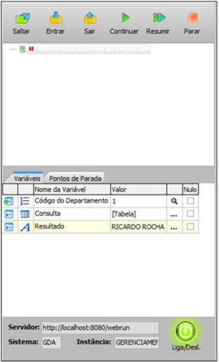

## Profiler

O Profiler é um utilitário estatístico para avaliação das regras associadas a um sistema, que foram configuradas para serem executadas na camada Servidor. Ele identifica possíveis gargalos e evita que o produto final chegue até ao cliente com pouco desempenho.

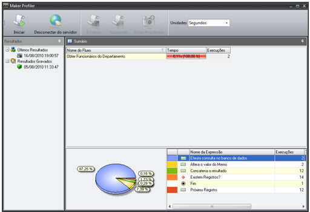

## Novas Funções

1. Obter Total de Linhas do Arquivo
2. Manter Cursores Após Commit
3. Associar Evento à Aba
4. Existe Componente?
5. Inserir Texto na Posição do Cursor no Texto Rico
6. Inserir texto na posição do cursor no Memo
7. Monitorar Posição do Cursor no Texto Rico
8. Monitorar posição do cursor no Memo
9. Moldura - Habilitar com componentes internos
10. Moldura - Mostrar com componentes internos
11. Moldura - Mover com componentes internos
12. Executar Fluxo no Formulário numa Moldura
13. Obter valor do componente do formulário da moldura
14. Grade - Checkbox Marcar Todos
15. Grade - Mostrar barra de edição
16. Tabela - Alterar folha de estilo do elemento
17. Tabela - Associar Evento a Linha ou Célula
18. Abrir ActiveX numa moldura
19. CSS - Importar conteúdo da folha de estilo
20. CSS - Importar folha de estilo
21. Logger - Adicionar Mensagem
22. Obter Pilha do Erro
23. Obter versão do Webrun
24. Diretório de arquivos de configuração
25. Upload Múltiplos arquivos
26. Lista Dinâmica - Definir Tipo
27. Email - Email do remetente da mensagem
28. Agendar Execução de Fluxo sem Pai
29. Remover vínculo de parentesco entre fomrulários
30. Obter Caminho do WFRE
31. Chamar Serviço Web (SOAP1.2)
32. Chamar Serviço Web (SOAP1.2) - Certificado Digital
33. Obter String Biométrica
34. Áudio/Vídeo Conferência - Enviar Stream de Webcam
35. Áudio/Vídeo Conferência - Fechar Stream
36. Áudio/Vídeo Conferência - Receber Stream
37. Enviar Envelope Soap

## Remoção de campos através do assistente de criação de tabelas.

Ao remover um componente da tela, caso o mesmo esteja ligado a um campo do banco de dados, será aberto o Assistente de Criação de Tabelas, perguntando se deseja remover este campo da tabela.

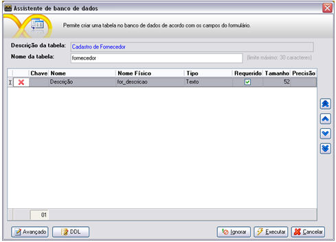

As colunas presentes nesta tela são:

- Chave: Indica se o campo é chave primária da tabela
- Nome: Descritivo do campo no dicionário de dados
- Nome Físico: Nome real da tabela no banco de dados
- Tipo: Tipo do campo
- Requerido: indica se o campo é obrigatório ou não.
- Tamanho: Tamanho do campo
- Precisão: Para campos fracionados, indica a precisão do campo

Observação: Caso o campo seja uma chave estrangeira, este não poderá ser removida, a menos que a chave estrangeira seja apagada antes do banco de dados.

## Melhoria na performance de leitura/gravação no banco de dados da IDE

Pode ser selecionado onde será guardado o cache dos metadados na opção "Nível do Cache" da tela de Configurações:

- Em memória: Na memória RAM.
- Persistente: Em disco.

Para reinicializar o cache, tecle F5. Sempre que o Maker for fechado, o cache será removido.

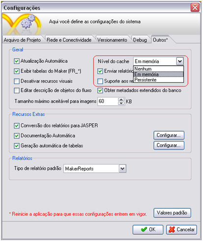

## Otimização do processo de gravação nos formulários

O processo de salvar os formulários se tornou visivelmente mais rápido

## Diretório das comunidades Maker integradas na IDE

Link direto para as principais comunidades Maker na Web. É acessada através do menu "Ajuda".

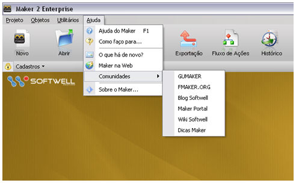

## Melhorias na interface do editor de fluxos

Busca mais inteligente na lista de fluxo e funções, agora a descrição é levada em consideração na pesquisa.

## Salvar a posição e tamanho do montador de expressão, e permitir que a lista de função sejam unidas (dock) ao editor

É possível alterar o tamanho da tela do montador de expressão, personalizando o tamanho ao gosto do usuário, permitindo também anexar a janela de Propriedades no Montador de Expressão através do botão "Anexar Janela/Janela Flutuante".

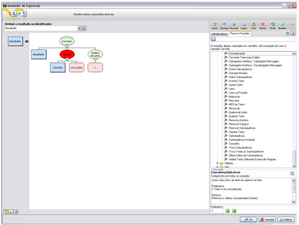

## Melhoria dos componentes SUBFLUXO e INTERAÇÃO para permitir uma rápida definição dos parâmetros

Agora é possível atribuir o valor dos parâmetros de subfluxos e interações diretamente, sem a necessidade de abrir o Montador de Expressão, com a identificação imediata do tipo passado, caso seja digitado um texto o valor do parâmetro será automaticamente do tipo Letras, caso seja digitado um valor fracionado ele será automaticamente do tipo Fracionado. Um ícone indica o tipo do valor digitado. Para passagens de parâmetros personalizadas, há a opção de abrir o Montador de Expressão.

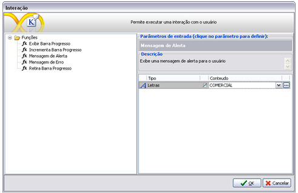

## Identificação visual do SIM/NÃO da decisão, independente da descrição

Há uma identificação para cada saída de uma decisão, a saída SIM possui cor verde e a saída NÃO possui cor vermelha

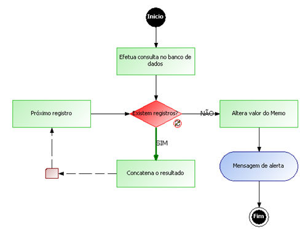

**Figura: Sim**

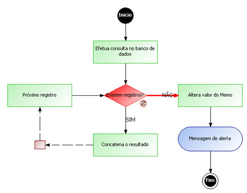

**Figura: Não**

## Opção "Obter Metadados extendidos do banco"

Na tela de configurações há esta nova opção que permite uma melhor performance na leitura dos dados do banco, no entanto, as chaves primárias e os tipos dos campos não são destacadas nos resultados das consultas.

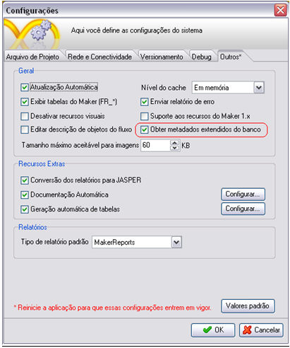

## Facilidade de associação de um fluxograma a um evento

É possível selecionar um fluxo e arrastá-lo até um componente do formulário, ou ao próprio formulário, serão listados os eventos disponíveis pelo objeto para a associação do fluxograma.

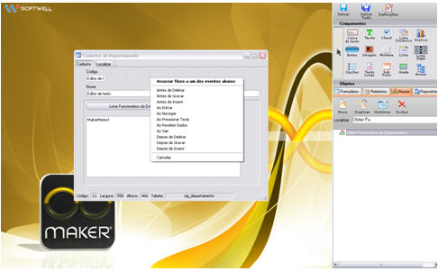

## Ícone de acesso rápido a um fluxo associado a um evento

Ao lado do nome do evento há um ícone que permite abrir o fluxo associado. Caso não haja nenhum fluxo associado ao evento desejado, ao clicar neste botão o Editor de Fluxos e Ações será aberto, ao salvar este fluxo ele será associado ao evento selecionado anteriormente.

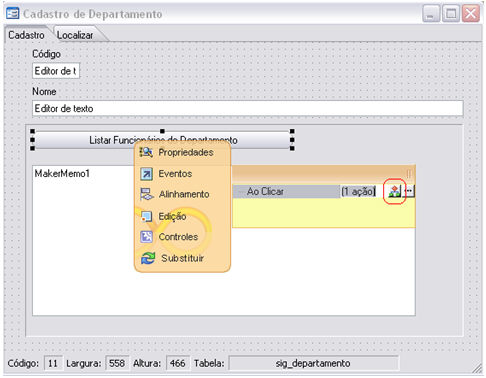

## Atualização de biblioteca para consumo de Webservices padrão SOAP 1.2

O Webrun 2.6 contém a biblioteca Axis 2.0 para suportar esta nova funcionalidade. Foram liberadas duas novas funções para consumir  Webservice neste padrão (SOAP 1.2).

Funções:

- Chamar Serviço Web (SOAP1.2)
- Chamar Serviço Web (SOAP1.2) - Certificado Digital

O padrão SOAP 1.2 será obrigatório para utilização da Nota Fiscal Eletrônica 2.0.

## Integração do Webrun com videoconferência (Softwell Media Server)

Agora é possível fazer Vídeoconferência utilizando o Webrun.

Estão disponíveis três novas funções para comunicação com o servidor de stream.

- Áudio/Vídeo Conferência  - Enviar Stream de Webcam
- Áudio/Vídeo Conferência - Receber Stream
- Áudio/Vídeo Conferência - Fechar Stream

As funções mais o servidor de stream (Softwell Média Server) estão disponíveis no link abaixo:

&lt;http://download.softwell.com.br/VideoConferencia.rar&gt;
