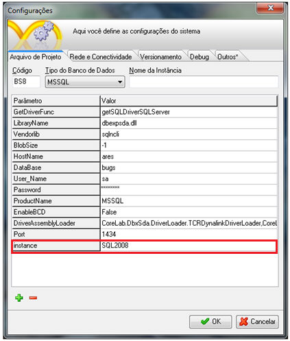

Para utilizar as configurações não usuais, por exemplo, porta diferente, múltiplas instâncias, entre outras, é necessário personalizar o seu arquivo [database.xml](../../estrutura_maker_e_webrun/arquivo_databases_xml).

## Como usar instâncias no MS SQL Server

1. Ative a tela [Configurações](../../maker_2/configuracao_das_conexoes/configuracoes) e adicione um parâmetro chamado instance. ao arquivo de projeto (WFRE): instance=&lt;nome da instância definida na instalação do SQL Server&gt;. Exemplo:

Isso irá instruir o Webrun a usar o valor do parâmetro instance na composição da string de conexão.

2. Personalizar o seu arquivo [database.xml](../../estrutura_maker_e_webrun/arquivo_databases_xml). que se encontra na pasta C:\Arquivos de programas\Softwell Solutions\Maker 2.7\Webrun 2\config. A string de conexão ficará parecida como:

&lt;group&gt;

   &lt;group-name&gt;MSSQL&lt;/group-name&gt;

                &lt;item&gt;

                     &lt;item-name&gt;Driver&lt;/item-name&gt;

                     &lt;item-param&gt;net.sourceforge.jtds.jdbc.Driver&lt;/item-param&gt;

                &lt;/item&gt;

                &lt;item&gt;

                     &lt;item-name&gt;URL&lt;/item-name&gt;

                     &lt;item param&gt;

                       jdbc:jtds:sqlserver://$HostName$:$Port:1433$/$DataBase$;**instance=$instance$**;charset=$SQLServerCharSet:iso-8859-1$;useLOBs=false;sendStringParametersAsUnicode=false;useCursors=true

                     &lt;/item-param&gt;

               &lt;/item&gt;
