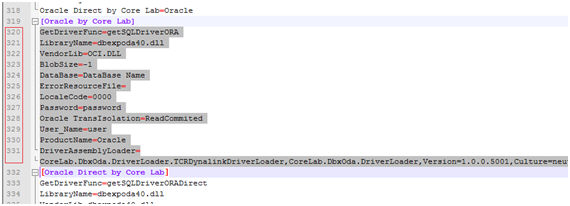
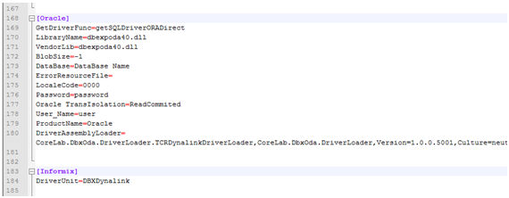
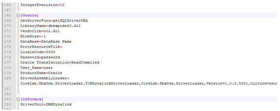
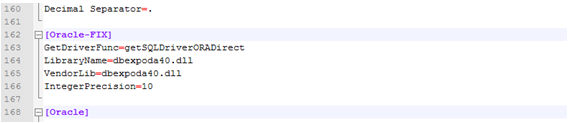
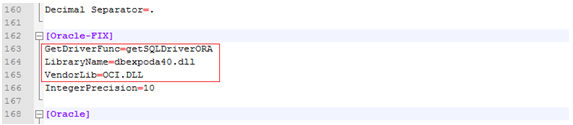
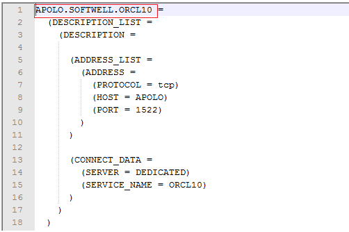
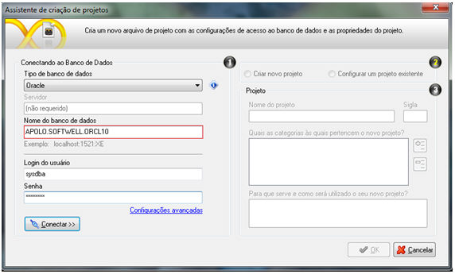

Para conseguir conectar via Maker um banco ORACLE pelo service_name, é necessário fazer algumas configurações:

1. Na pasta onde Maker está instalado (C:\...\Softwell Solutions\Maker) procure o arquivo drivers.ini;

Nota: sugerimos que seja feito um backup deste arquivo antes de ser feita qualquer alteração, apenas por motivo de segurança.

2. Abra este arquivo com bloco de notas (preferencialmente com bloco de notas para programadores, tipo Notepad++,  Cnote e etc.);
3. Procure o subgrupo [Oracle by Core Lab]. Selecione todo o conteúdo do subgrupo e copie (ctrl+c).

4. Procure agora o subgrupo [Oracle] e cole (ctrl+v) dentro deste subgrupo, substituindo o conteúdo pelo que foi copiado anteriormente;

Antes:

Depois:

Após substituir o conteúdo do item anterior, copie (ctrl+c) as três primeiras linhas deste mesmo subgrupo, [Oracle], e substitua (ctrl+v) pelas três primeiras linhas do subgrupo anterior a este, [Oracle-FIX],

Antes:

Depois:

5. Depois de realizados estes passos, salve o arquivo e inicie o Maker e conecte com o banco através do service_name, do mesmo jeito que está salvo no arquivo TNSNames.ora, exemplo:

Arquivo tnsnames.ora:

Novo Projeto Maker:

As configurações do banco, bem como as configurações dos arquivos tnsnames.ora, listener.ora e sqlnet.ora, são de responsabilidades do cliente, onde este tutorial só irá funcionar se o banco estiver configurado corretamente.
