Neste tópico, será demonstrada a criação de uma tabela no componente **Moldura** a partir de uma lista.

1. Crie um formulário com os componentes **Textos**, **Moldura** e **Botão** e sem fonte de dados:

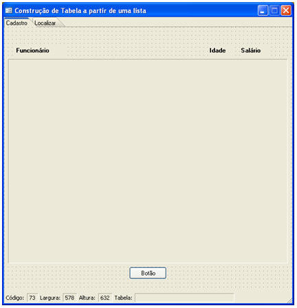

2. Antes de criar o fluxo, clique em no componente **Início** para informar o **Formulário de Trabalho**:

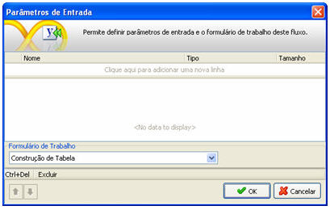

3. Pressione **F11** e crie os **Identificadores** (variáveis):

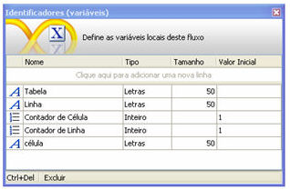

4. Agora partiremos para a criação do fluxo. Para facilitar o entendimento, o fluxo ficará da seguinte forma:

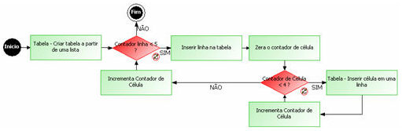

5. Insira um 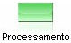 para criar uma tabela no componente **[Moldura](../../maker_2/formulario/componentes/moldura)** a partir de uma lista. No **[Montador de Expressão](../../maker_2/fluxos_e_acoes/montador_de_expressoes)**, na aba **Fluxos e Funções**, localize as funções **Tabela - Criar tabela a partir de uma lista**,**Tabela para Lista** e **Abrir Consulta**:

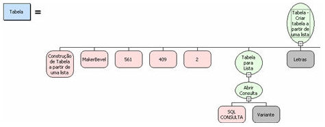

**Observações**:

1. Na imagem acima, observe que foram mostrados os parâmetros necessários para o preenchimento e os demais são opcionais.
2. No **SQL Consulta,** foi utilizada a tabela **sig_funcionario** e selecionado os campos: **sig_funcionario.fun_nome**, **sig_funcionario.fun_salario** e **sig_funcionario.fun_idade**.

6. Insira uma 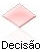 para verificar a quantidade de linha. Com isso será feito o controle de linhas inseridas na **Moldura**. No **[Montador de Expressão](../../maker_2/fluxos_e_acoes/montador_de_expressoes)**, na aba **Fluxos e Funções**, localize a função **Menor**:

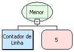

7. Insira um 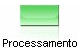 para inserir linha em uma tabela. No **[Montador de Expressão](../../maker_2/fluxos_e_acoes/montador_de_expressoes)**, na aba **Fluxos e Funções**, localize a função **Tabela - Inserir linha em uma tabela**:

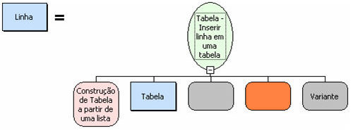

8. Insira um  para inicializar a variável **Contador de Célula**. No **[Montador de Expressão](../../maker_2/fluxos_e_acoes/montador_de_expressoes)**, na aba **Identificadores**, tipo **Inteiro** adicione **1**:

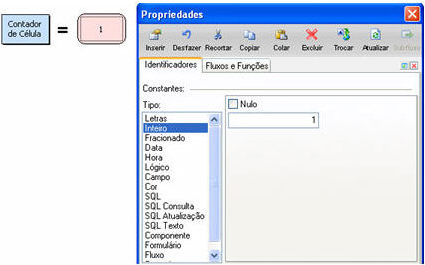

9. Insira uma 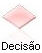 para verificar a quantidade de células. Com isso será feito o controle de células inseridas na **Moldura**. No **[Montador de Expressão](../../maker_2/fluxos_e_acoes/montador_de_expressoes)**, na aba **Fluxos e Funções**, localize a função **Menor**:

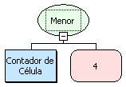

10. Insira um 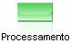 para inserir células em uma linha. No **[Montador de Expressão](../../maker_2/fluxos_e_acoes/montador_de_expressoes)**, na aba **Fluxos e Funções**, localize a função **Tabela - Inserir célula em uma linha**:

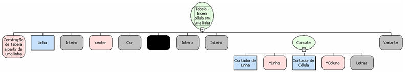

11. Insira um  para incrementar a variável **Contador de Célula**. No **[Montador de Expressão](../../maker_2/fluxos_e_acoes/montador_de_expressoes)**, na aba **Fluxos e Funções**, localize a função **Soma**:

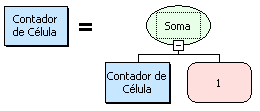

**Associando fluxo a Evento**: Associe este fluxo ao formulário criado, aplicando ao componente **Botão** e ao **Evento** "**Ao Clicar**" e veja o resultado no Webrun:

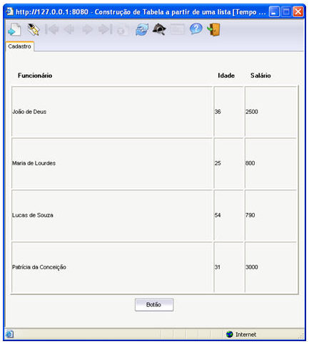
