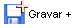

Supondo que, no formulário, exista um fluxo que capture o valor de um componente, após utilizar o botão , o conteúdo não é obtido.

Quando você utiliza , o formulário entra em modo de inclusão. Isso quer dizer que os campos estarão nulos ou com seus valores padrão. Por isso, não conseguirá obter valores que foram definidos na sua última inserção.

Caso necessite de algum valor definido em componentes, utilize a **variável de sessão** e regra do tipo **servidor**.

Nos links abaixo, seguem exemplos com a **Variável de Sessão:**

- [Utilizando Variável de Sessão](../funcoes/utilizando_variavel_de_sessao);
- Filtro de pesquisa de Relatório utilizando Variável de Sessão.
