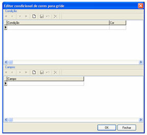
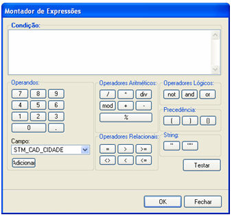
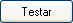
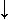

Os passos a seguir ajudarão a utilizar o recurso de Cor Condicional no componente Grade.

1. Desenvolva um formulário e insira um componente [Grade](../../maker_2/formulario/componentes/grade).
2. Clique no componente com o botão direito do mouse e defina as [Propriedades](../../maker_2/formulario/propriedades_e_eventos) básicas (Formulário, SubFormulário, Parâmetros e Colunas).
3. Ainda em Propriedades, clique no botão  (construtor) ao lado da propriedade [CorCondicional](../../maker_2/formulario/propriedades_e_eventos). É exibida a tela Editor condicional de cores para grade:

A tela é composta, simplesmente, por duas áreas: Condição (que define o critério e a cor) e Campo (define o(s) campo(s) para receberem a formatação).

Execute clique duplo no campo Condição para ativar a tela Montador de Expressões para criar o critério da formatação.

Para visualizar a tela Montador de Expressões, .

Esse Montador de Expressão é característica da [Propriedade Cor Condicional](../../maker_2/formulario/propriedades_e_eventos) do componente [Grade](../../maker_2/formulario/componentes/grade).

É muito utilizado para adicionar cor nos campos da tabela.

A tela é composta por várias áreas:

1. 1. - Condição - local onde escreve-se a condição para formatação;
      - Operadores - utilizado para atribuir valor:
      - - Campo - permite escolher campos disponíveis na consulta do formulário. Após selecionar o campo, utilize o botão  (adicionar).

Exemplos:

&lt;campo&gt; = &lt;inteiro&gt;

STM_CAD_ID = 1

&lt;campo&gt; = &lt;valor inteiro&gt;

Fun_idade = 18 ou Fun_idade &gt; 18

&lt;campo&gt; = &lt;valor fracionado&gt;

Fun_salario = 3489.90

1. 1. - Operadores - parte composta pelo teclado numérico e o ponto (observar que utiliza-se o padrão norte americano para separar casas decimais);

1. 1. - Operadores Aritméticos:
      - - Botão  - divisão;
        - Botão  - multiplicação;
        - Botão  - operador para retornar o resultado da divisão de inteiros;
        - Botão  - soma;
        - Botão  - subtração;

1. 1. 1. - Botões  - foi depreciado. Utilize o botão , pois a resultado será o resto (módulo) da operação inteira;

1. 1. - Operadores Relacionais - estes operadores permitem comparar duas ou mais variáveis:

Exemplo:

&lt;campo&gt; = &lt;campo&gt;

Fun_codigo = fun_setor_codigo

&lt;campo&gt; = "&lt;null&gt;"

Fun_tel = ""

Observação: Os tipos dos campos devem ser iguais;

1. 1. - Operadores Lógicos - composto pelos botões ,  e ;

Exemplo:

&lt;campo&gt;

Fun_ativo

Observação: Adicionar apenas o campo lógico, pois retornará True ou False;

Importante: Para o tipo Lógico (acima citado) é aplicável a partir da Versão Webrun 2.2.0.8m.

1. 1. - Precedência - botões que são utilizados para separar sentenças (uso de parênteses);

1. 1. - String - são delimitadores de caracteres;

Exemplo

&lt;campo&gt; = "&lt;String&gt;"

fun_nome = "Machado de Assis"

Importante: Para o tipo String (acima citado) é aplicável a partir da Versão Webrun 2.2.0.8m.

1. 1. - Botão  - verifica a condição transcrita no local Condição.

1. 1. - Botão  - confirma a condição criada. Retorna a tela Editor condicional de cores para grade;
      - Botão  - fecha a tela Montador de Expressão sem confirmação da condição. Retornando a tela Editor condicional de cores para grade.

4. Após definir a expressão condicional e sair da tela Montador de Expressões, selecione a Cor executando clique duplo no próprio campo Cor.
5. Por fim, selecione o(s) campo(s) para serem formatados. Utilize o botão  (Novo) ou  (teclado). Utilize o botão  (salvar) para gravar.

Observações:

1. Os campos que fornecem o valor para a condição são campos com componentes do tipo [Caixa de Texto](../../maker_2/formulario/componentes/caixa_de_texto) ou [Lista](../../maker_2/formulario/componentes/lista) (com campo chave e lista iguais).
2. Campos somente leitura não receberão a cor condicional.
