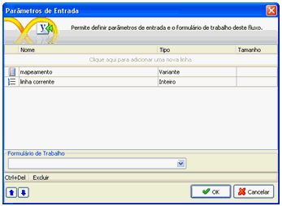
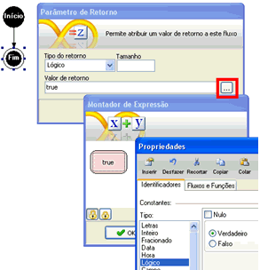
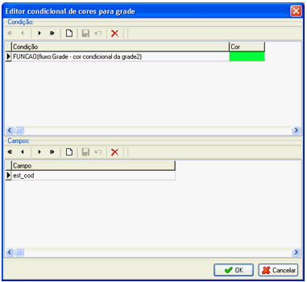
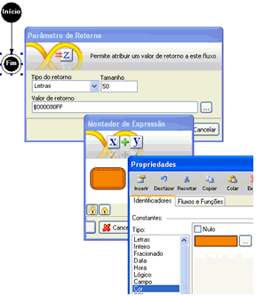

# Como utilizar cor condicional em grades por meio de fluxograma

Existem duas maneiras de interagir com a Propriedade Cor Condicional do componente [Grade](../../maker_2/formulario/componentes/grade) pelo fluxo de ações:

- utilizando um fluxo que retorne um valor lógico;
- utilizando um fluxo retornando uma cor.

Exemplo 1: Fluxo retornando um valor lógico:

Crie um novo fluxo e defina dois Parâmetros de Entrada: mapeamento (do tipo Variante) e linha corrente (do tipo Inteiro).

Observação: É obrigatória a exata definição desses parâmetros nessa ordem e tipo:

O parâmetro denominado linha corrente, do tipo inteiro, receberá a linha corrente do componente Grade, e o parâmetro denominado mapeamento, do tipo variante, receberá o mapeamento do tipo [coluna, valor da coluna].

O parâmentro mapeamento passa como chave o campo do banco de dados em UperCase, ou seja, passa a palavra em maiúsculo. Por exemplo, caso se queira uma chave que tem como nome fun_cod, deve-se obter o valor da chave FUN_COD do objeto.

Mesmo que não utilize esses parâmetros, mantenha-os. Para apenas ilustrar o exemplo, o fluxo terá uma ligação direta do Início ao Fim, onde definiremos, no componente Fim, o retorno do valor lógico (usar constante):

O fluxo poderá ser salvo tanto na camada Cliente como na camada Servidor.

Observação: O preenchimento será feito somente se o Valor de retorno for True.

Retornando ao formulário, ative a Propriedade Cor Condicional do componente Grade e observe, na ilustração abaixo, como aplicar o fluxo com a propriedade:

No campo Condição, utilizamos um parâmetro comum denominado FUNCAO (o mesmo utilizado para definir Valor Padrão dos campos para formulário), definindo FUNCAO(fluxo:&lt;nome do fluxo&gt;) e, na coluna Cor, selecione a cor desejada. No campo abaixo, selecione o campo da grade que será formatado.

Observação: Os parâmetros de entrada poderão ser utilizados com componentes Decisão para definir critérios para aplicar a Cor Condicional. Os valores para as declarações dos Parâmetros de Entrada especificados neste exemplo serão passados automaticamente pelo Webrun que reconhece estas variáveis.

Exemplo 2: Fluxo retornando uma cor:

Basicamente, aplicam-se os mesmos procedimentos descritos acima, mudando apenas na utilização da Constante Cor:

Observação: Como é necessário definir a cor no Editor condicional de cores para grade, a grade exibirá a cor definida no fluxo porque possui prioridade.

Cor Condicional da Grade por fluxo - Este exemplo demonstra como utilizar a Propriedade Cor Condicional personalizada por fluxo.
