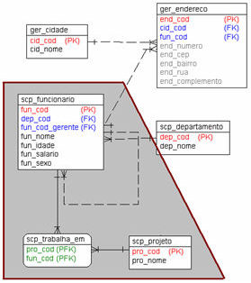
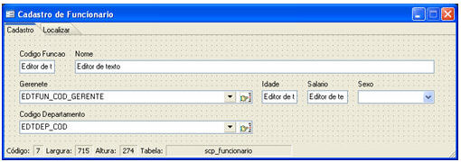
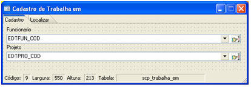
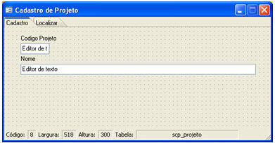
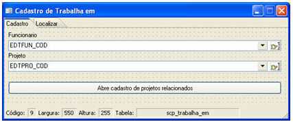
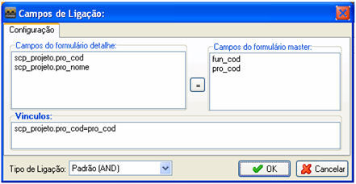
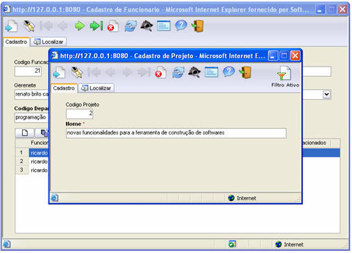
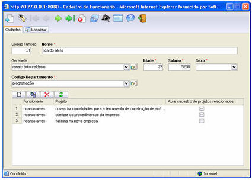

Projeto: Desenvolver um formulário com um componente [Grade](../../maker_2/formulario/componentes/grade), onde uma das colunas possui botão que chama um formulário. O formulário terá o seguinte layout ao final:

Inicialmente, observe, na modelagem abaixo, a área em destaque:

Serão criados três formulários:

- Da tabela scp_funcionario, criaremos o formulário Cadastro de Funcionários:

- Da tabela scp_trabalha_em, criaremos o formulário Cadastro Trabalha em:

- Da tabela scp_projeto, criaremos o formulário Cadastro de Projeto:

Observação: Utilize o Assistente de criação de múltiplos formulários para criar rapidamente as telas, adicionando-os a um menu do sistema.

Altere o formulário Cadastro Trabalha em:

- Aumente a altura do formulário e adicione um [Botão](../../maker_2/formulario/componentes/botao) cujo Evento ao clicar, abra o formulário, Cadastro de Projeto. O formulário ficará com a seguinte aparência:

Observação: Quando adicionamos um botão a um formulário com a ação Abrir Formulário, este deve ser parametrizado: pela Propriedade Formulário, informe qual formulário deverá ser aberto, e pels Propriedade Parâmetros, defina o tipo de relacionamento entre o formulário pai e filho;

- Todo botão que chama formulário abrirá o objeto em modo filtrado.

Altere o formulário Cadastro de Funcionários:

- Aumente a altura do formulário e adicione um componente Grade, com as seguintes Propriedades:
- - Formulário - Cadastro de Trabalha em;
  - Parâmetros - ;
  - Colunas - apenas a coluna Projetos;
  - Editável - Sim.

Observação: Caso não informe que a Grade é editável, não será herdado o botão do formulário Cadastro de Trabalha em (nosso objetivo, neste exemplo).

Após salvar as alterações e rodar o sistema no Webrun, o formulário deverá possuir a seguinte aparência:

Observação: Este banco de exemplo pode ser adquirido pelo setor de Treinamento da Softwell Solutions.
