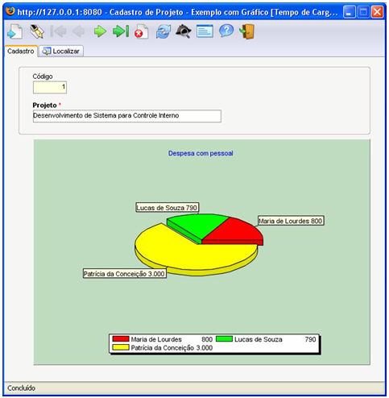
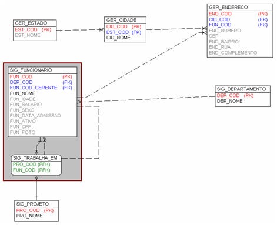
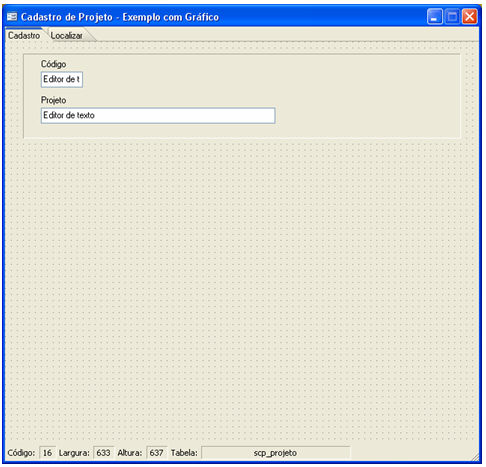
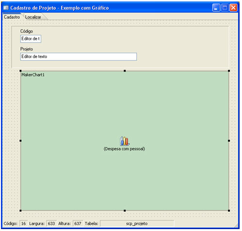
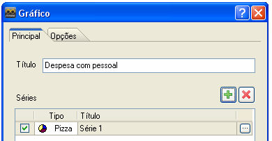
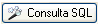

# Exemplo de Gráfico no Formulário

A dica a seguir exemplificará a utilização do componente Gráfico para exibição de dados. O formulário final terá o seguinte *layout*:

Observe a modelagem das entidades envolvidas:

Este formulário deve apresentar, em um gráfico do tipo circular de setores, os funcionários destinados ao projeto e detalhar os valores correspondentes ao salário de cada um envolvido.

1. Criar o formulário principal baseado na tabela sig_projeto

2. Inserir um componente Gráfico no formulário e configurar

Configure o componente da seguinte forma:

- Para a Propriedade Cor, selecione uma cor que vai preencher todo o espaço equivalente a área do gráfico;
- Para a Propriedade Título, determine o título principal para o gráfico. Por exemplo Despesa com pessoal;
- Para a Propriedade Legenda, confirme a exibição selecionando Sim;
- Para a Propriedade Posição da Legenda, defina Abaixo (como exemplo);
- Para a Propriedade Estilo da Legenda, defina Automático (como exemplo);
- Para a Propriedade Conteúdo da Legenda, defina Etiqueta e Valor (como exemplo);
- Para a Propriedade Cor da Legenda, defina Branco (como exemplo);
- Para a Propriedade Mostrar 3D, defina Sim (como exemplo);
- Para a Propriedade Séries, configure os seguintes itens:

  - Clique no botão  (Adicionar) para adicionar uma Série para o gráfico:

- No campo check da grade Séries, permaneça com este item ativo para que a série seja utilizada na constituição do gráfico;
- Na coluna Tipo da grade Séries, clique no local e selecione o Pizza;
- Na ultima coluna desta grade, clique no botão  (Construtor) para configurar a série do gráfico:

  - Ative a opção Cor para cada, para que cada fatia do gráfico tenha uma identificação diferenciada;
  - Na aba Fonte de dados, clique no botão  para ativar o Assistente SQL e monte a consulta da série do gráfico:

  Select

  RTrim(sig_funcionario.fun_nome) As Nome,

  sig_funcionario.fun_salario

  From

  sig_trabalha_em Inner Join

  sig_funcionario On sig_trabalha_em.fun_cod = sig_funcionario.fun_cod

  Where

  sig_trabalha_em.pro_cod = :pro_cod

  - Na aba Fonte de dados, informe para o Campo Etiqueta, ou seja, para os rótulos principais, rótulos que serão impressos ao lado de cada fatia do gráfico ou serão utilizados na legenda do gráfico;
  - Na aba Fonte de dados, informe o Campo Valor, ou seja, os valores que serão impressos ao lado de cada fatia do gráfico ou serão utilizados na legenda do gráfico;
  - Na aba Opções, defina o valor 20 no campo Distância da maior fatia para que esta esteja em evidência.

3. Clique em Ok para sair da tela Propriedades da Série;
4. Na aba Opções da tela Gráfico, defina selecione uma Cor de Fundo para área do gráfico.

Agora ajuste o tamanho da área do gráfico e salve o formulário.

Utilizando o componente Gráfico - este vídeo exemplifica a utilização do componente Gráfico.
