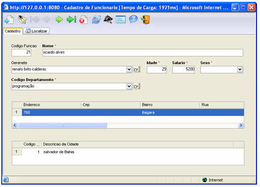
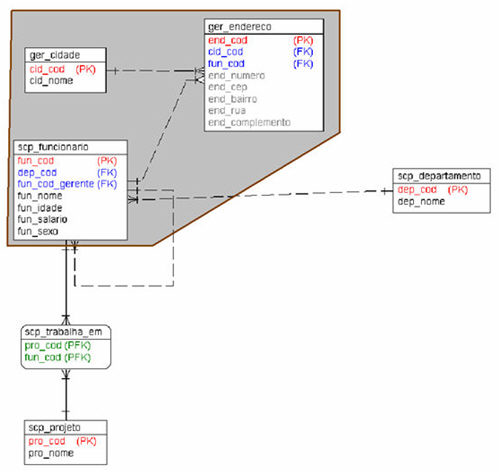
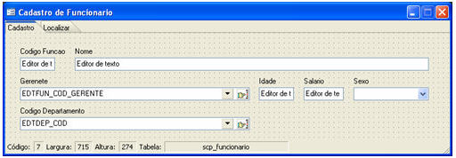
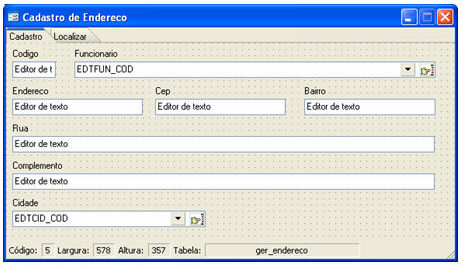
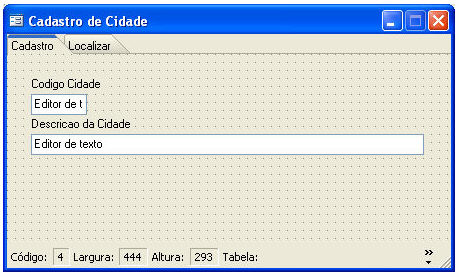
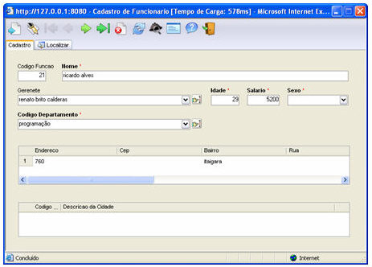

Este recurso permite que o conteúdo de uma grade Detalhe seja filtrado pelo conteúdo selecionado em uma Grade Mestre.

Projeto: Desenvolver um formulário com dois componentes Grade, onde o conteúdo da segunda grade (chamada de Detalhe) será filtrado pela seleção do registro exibido na primeira grade (chamada de Mestre). A primeira grade apresentará o endereço do funcionário e a segunda indicará a cidade correspondente. Ao final, o formulário terá o seguinte *layout*:

Inicialmente, observe, na modelagem abaixo, a área em destaque:

Serão criados três formulários:

1. Da tabela scp_funcionario, criaremos o formulário Cadastro de Funcionários:

2. Da tabela ger_endereco, criaremos o formulário Cadastro de Endereço:

3. Da tabela ger_cidade, criaremos o formulário Cadastro de Cidade:

Observe abaixo as alterações no formulário Cadastro de Funcionários:

1. Redimencione o formulário Cadastro de Funcionário;
2. Insira dois componentes Grade:
   1. A primeira grade possui a Propriedade Formulário = Cadastro de Endereço e o vínculo com o formulário Cadastro de Funcionário é ger_endereco.fun_cod=fun_cod;
   2. A segunda grade possui a Propriedade Formulário = Cadastro de Cidade e o formulário possui a propriedade Entrar como pesquisa = Sim;

OBSERVAÇÃO: DEVE-SE VERIFICAR A ORDEM DE TABULAÇÃO DAS GRADES: A TABULAÇÃO DA GRADE MESTRE DEVE ANTECEDER A DA GRADE DETALHE.

1. Clique na segunda Grade e selecione a Propriedade Grade Mestre, acionando a propriedade pelo botão  (construtor) ao lado;
2. Na tela Ligação entre as Grades, defina:
   1. No campo Grade Mestre, selecione a grade do Cadastro de Endereço;
   2. No campo Campo Meste, selecione o campo relacional entre os dois objetos grade. Seguindo o exemplo, utilize o campo cid_cod;
   3. No campo Detalhe, selecione o ger_cidade.cid_cod, seguindo o exemplo;
   4. Utilize o botão  para acrescentar os campos relacionais ou utilize o botão  para excluir.
3. Salve o formulário Cadastro de Funcionários e execute no Webrun.

Observa-se que, ao acessar o formulário, a segunda grade apresenta-se vazia pois o conteúdo filtrado só ocorre ao clicar no registro da Grade Mestre.

Observações:

1. Nas consultas das grades **Mestre** e **Detalhe**, não podem conter apelidos(**ALIAS**) nos campos que serão relacionados na propriedade "**Grade Mestre**".
2. A partir da versão 2.3.0.1 do Webrun, a grade mestre apresenta o ponteiro no primeiro registro, enviando-o como parâmetro para a grade secundária.
3. Na propriedade Grade Mestre a última grade não será selecionada, pois não terá outra grade para referenciá-la.
