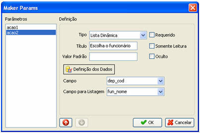
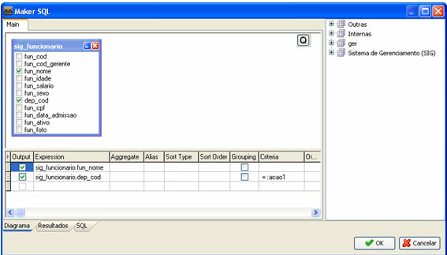
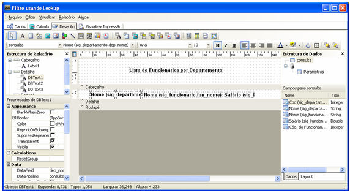

# Utilizando dois filtros de pesquisas (Lista Dinâmica) em Relatório

Neste tópico, será mostrada a utilização de dois Filtros de Pesquisas por meio do componente [Lista Dinâmica](../../maker_2/formulario/componentes/lista_dinamica).

O exemplo listará o Departamento e, em seguida, listará todos os Funcionários desse departamento. Neste exemplo, foram utilizadas as tabelas: SIG_DEPERTAMENTO e SIG_FUNCIONARIO.

Siga os passos abaixo:

1º passo - Na aba Relatório, clique em 

Na tela acima, clique em 

Observações:

1. No campo 

   2. Após seleção da tabela SIG_DEPARTAMENTO, confirme a tela;
   3. Na tela Maker Params e no campo Campo selecione a opção dep_cod.
   4. No campo Campo para Listagem selecione a opção dep_nome;
   5. Após ter selecionados os campos, confirme a tela.

   4º passo - Continuando na tela Maker Params, selecione o parâmetro acao2:

   

   defina os dados do parâmetro acao2:

na área Detalhes. Para cada componente associe aos campos selecionados no Passo 3 (DEP_NOME, FUN_NOME e FUN_SALARIO):

