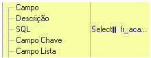
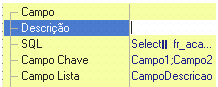
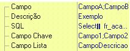

O componente lista dinâmica possibilita a utilização de chave composta

Chave composta é quando o identificador único de uma tabela é formado por dois ou mais campos, que podem ou não ser chaves primárias.

Para proceder a essa configuração, siga os passos abaixo:

1. Vincule uma consulta e selecione os campos chaves e um campo descrição na propriedade SQL do componente Lista Dinâmica

2. Escreva os nomes dos campos que compõem a chave separados por ponto e vírgula na propriedade Campo chave. Exemplo: campo1;campo2;campo3. Estes campos devem ser selecionados na consulta vinculada ao componente

3. Escreva os nomes dos campos que compõem a chave separada por ponto e vírgula na propriedade Campo. Exemplo: campo1;campo2;campo3. Estes campos foram selecionados na consulta vinculada ao formulário.

Observações:

- Ao utilizar a função Obter valor do componente, o retorno será do tipo letras com o seguinte formato: FieldValue[CAMPO|valor]FieldValue[CAMPO2|valor]FieldValue[CAMPOn|valor], o mesmo ocorre ao utilizar o componente para passar valores como parâmetro de entrada.
- Está funcionalidade só é útil quando a propriedade Campo da Lista dinâmica estiver preenchida.
