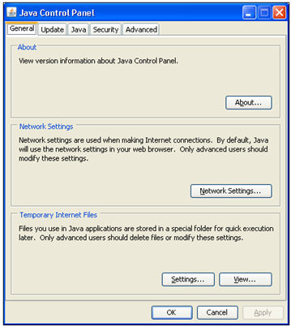
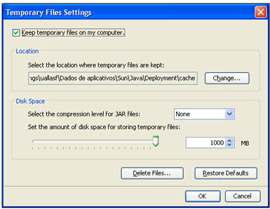

# Internacionalizando Applet do Leitor Biométrico

A partir do Webrun 2.5.0.30, a Softwell Solutions disponibilizou uma nova versão do applet do leitor biométrico internacionalizado. Com isto, o applet irá se apresentar em inglês ou português, de acordo com a língua selecionada no seu sistema.

Para visualizar as alterações, devem-se seguir alguns passos:

1. Parar o servidor de aplicações.

2. Excluir os arquivos temporários do JAVA.

Painel de Controle -> Java

Na aba General, verifique as configurações dos arquivos temporários do JAVA clicando em Settings.

Então será aberta uma nova janela de configurações de arquivos temporários.

Clique em "Delete Files...". Após isso, o applet terá sido removido com sucesso.

3. Excluir a pasta NBIo do usuário corrente.

Exclua a pasta C:/Documents and Settings/usuário/NBIo

4. Inicie novamente o servidor de aplicações.

Após isso, o applet internacionalizado estará disponível.
