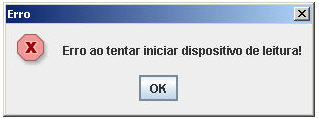

Ao tentar utilizar o [Identificador Biométrico](../../maker_2/instalacoes/como_instalar_o_servidor_biometrico) no mesmo browser para mais de um sistema que estejam abertos, é possível que apresente a mensagem abaixo:

Erro: Erro ao tentar iniciar dispositivo de leitura!

,

pois a dll (biblioteca) do Identificador já está instanciada para um outro sistema da jvm (servidor tomcat).

Além disso, o sistema operacional não permite acesso duplo a uma dll. Para que funcione corretamente, é necessário reiniciar o browser antes de acessar novamente o applet do outro sistema.
