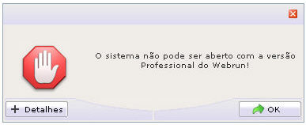
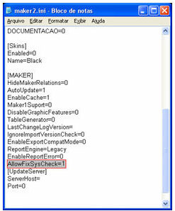
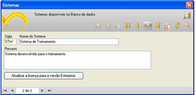

Este recurso é aplicado para ajustar o valor do campo SIS_CHECK, da tabela FR_SISTEMA, quando estiver aparecendo a mensagem que não pode abrir um projeto:

Erro: O sistema não pode ser aberto com a versão Professional do Webrun!

Isso ocorre, quando o Maker não armazena o valor correto durante a criação do novo projeto.

Siga os passos:

1. Feche o Maker;
2. Abra o Windows Explorar e acesse a pasta C:\Documents and Settings\&lt;usuário&gt;\Configurações locais\Dados de aplicativos\Softwell Solutions\Maker 2;
3. Abra o arquivo maker2.ini;
4. Adicione a linha AllowFixSysCheck=1 no agrupamento [Maker]:

5. Salve a modificação executada no arquivo;
6. Em seguida, por meio do Maker, abra o projeto no qual houve o problema do não reconhecimento da versão e ative o item Lista de Sistemas do menu Projeto. Assim que a tela aparecer, navegue até o sistema no qual houve o problema e clique sobre o botão Atualizar a licença para a versão Enterprise.

7. Por fim, reinicie o Webrun para que este reconheça as novas configurações do projeto.
