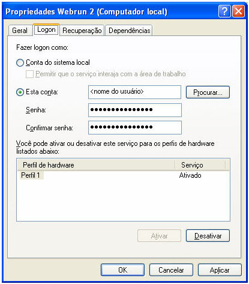

# Exibindo o nome do usuário logado

O nome do usuário padrão é SYSTEM. Para poder capturar o nome do usuário que ativou o serviço, deve então:

1. Configurar na tela Propriedades Webrun (na tela Serviços, no Windows, selecionar Propriedades pelo botão direito do mouse sobre o serviço Webrun2).
2. Selecione a opção Esta conta e, no campo, definir o nome da conta do usuário.

