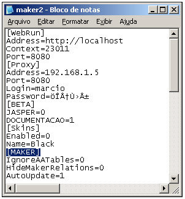

O Maker, por padrão, não consegue visualizar as tabelas de prefixo AAA_* após sincronizar o dicionário de dados.

Caso queira habilitar estas tabelas, siga os seguintes passos:

1. Vá ao diretório onde se encontra o arquivo *.ini de configuração do Maker:

C:\Documents and Settings\*&lt;login&gt;*\Configurações locais\Dados de aplicativos\Softwell Solutions\Maker 2\

Onde o &lt;login&gt; é o seu usuário no Windows.

2. Abra o arquivo Maker2.ini;
3. Localize a linha [MAKER];
4. Insira o parâmetro que segue, dentro deste grupo:

IgnoreAATables=0

5. Feche o Maker e abra novamente.

Após sincronizar novamente o dicionário de dados, ficará acessível a visualização das tabelas de prefixo AAA_*.
