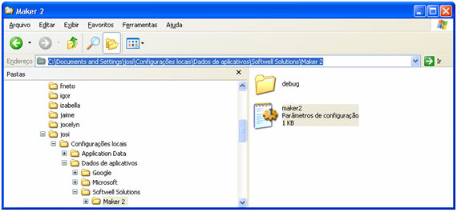
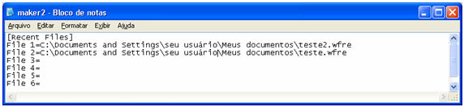

Caso o desenvolvedor exclua o banco de dados e o arquivo *.WFRE de um projeto, o seu nome permanece na lista dos Projetos recentes. Observe os passos para editar a lista.

O Maker cria o arquivo maker.ini na pasta C:\Documents and Settings\&lt;nome do usuário&gt;\Configurações locais\Dados de aplicativos\Softwell Solutions (originalmente, este arquivo possui o atributo Oculto).

Abra e edite o arquivo: apague os dados contidos na linha FILE n=, ou seja, apague o caminho referente ao arquivo que é exibido na tela Projetos recentes:

Ao retornar ao Maker, a lista Projetos recentes se apresentará limpa.
