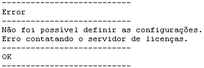
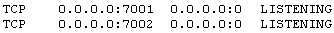

# Sentinel

O Sentinel é a ferramenta de proteção à sua cópia do Maker.

Licença Corporativa

Por padrão, o Maker localiza automaticamente o servidor de licença corporativa sendo executado na rede. Caso isso não ocorra automaticamente, é necessário definir manualmente o endereço do servidor. Utilize ***LicenseConfig.exe*** fornecido pela Softwell Solutions para criar um arquivo de configuração apontado para o servidor.

Este utilitário é de simples manuseio. Siga os passos abaixo:

1. Copie o executável para a pasta do Maker.
2. Digite o endereço ***IP*** do servidor no campo apropriado.
3. Clique sobre Aplicar;

   1. Se tudo ocorrer bem, serão apresentados os dados do servidor conectado para poder usar o Maker;
   2. Se houver algum problema, será apresentada uma mensagem de erro:

Para resolver o erro acima, certifique-se de que o atalho tenha a "Pasta de Trabalho" definida para a pasta do Maker:

1. Clique com o botão direito do mouse sobre o atalho e selecione a opção Propriedades;
2. Verifique o campo Iniciar em. Este campo deve estar definido para a pasta do Maker, por padrão "C:\Arquivos de programas\Softwell Solutions\Maker 2.7\". Caso não esteja, defina para pasta correta e tente novamente.

Caso apresente algum erro diferente do erro apresentado acima, verifique se há algum erro na licença corporativa:

Verificando a conexão com o servidor de licenças:

Caso não esteja conectando ao servidor de licenças corporativas, realize os testes abaixo:

1. Certifique-se de que haja licenças disponíveis no servidor. Para saber, abra o navegador e digite o endereço do IP servidor seguido de ":7002" (que é a porta onde o serviço). Ficará algo como o exemplo abaixo:

http://ip_do_servidor:7002/

A tela que será aberta poderá verificar se há ou não licenças disponíveis. Havendo disponibilidade de licenças, o problema é de outra natureza.

2. Verifique se há conectividade de rede, utilizando a porta 7001. No prompt do DOS, execute o seguinte comando:

telnet ip_do_servidor 7001

Se retornar algum erro, é porque há uma falha na comunicação de rede entre a máquina cliente e o servidor, provavelmente um Firewall. Faça os testes básicos de conectividade para certificar-se de que não existe nenhum problema de rede entre a máquina cliente e o servidor.

3. Verifique se as portas 7001 e 7002 estão liberadas no firewall do servidor de licenças (lembre-se do firewall nativo do Windows). Não estando liberado o acesso no Firewall, libere-as porque essas portas são usadas pelo servidor de licenças.

4. Verifique se o serviço está sendo executado no servidor. Siga os passos abaixo:

   1. No servidor de licenças, execute o comando (Iniciar->Executar) services.msc;
   2. Será aberto o gerenciador de serviços do Windows;
   3. Localize o serviço Sentinel Keys Server:

Encontrando o serviço, certifique-se de esteja rodando. Se não estiver rodando, inicie o serviço e tente novamente.

Caso não encontre o serviço, isso significa que ele não está instalado. Instale-opor meio do DVD de instalação do Maker.

5. Verifique se as portas 7001 e 7002 estão abertas no servidor, e se o serviço está funcionando. Para tal, execute os seguintes passos:

   1. Abra o prompt do DOS;
   2. Execute o seguinte comando: netstat -an;
   3. Localize as portas 7001 e 7002 e verifique se o status está como LISTENING, como no exemplo abaixo:
      

Observações:

1. Caso não sejam listadas as portas, significa que o serviço não está sendo executado;
2. Se a porta estiver sendo listada e mesmo assim, não consegue conectar-se, execute os passos abaixo:

   1. Pare o serviço do Sentinel Keys Server;
   2. Execute novamente o netstat -an e verifique se a porta continua listada. Se estiver sendo listada é porque uma outra aplicação está utilizando a porta do Sentinel. Será, então, necessário remover essa aplicação ou trocar a porta que ela utiliza.

Se algum outro problema persistir, entre em contato com a [Central de Suporte](../../suporte_ao_maker) do Maker.
