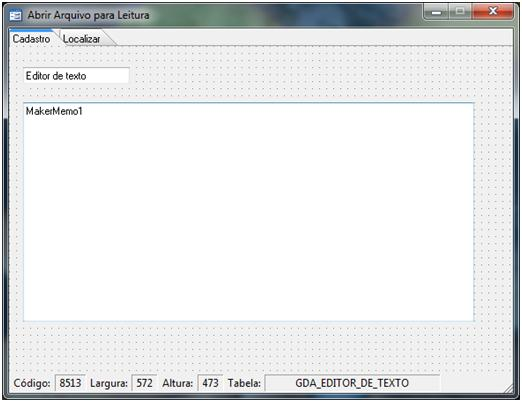
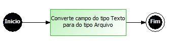
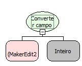
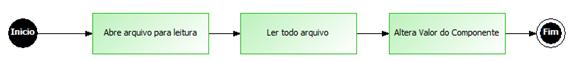
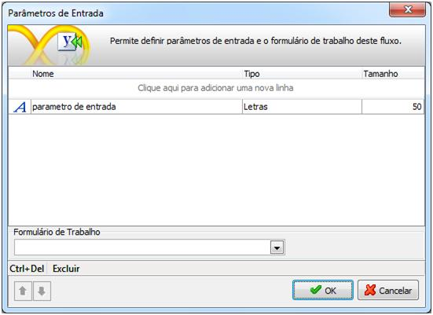
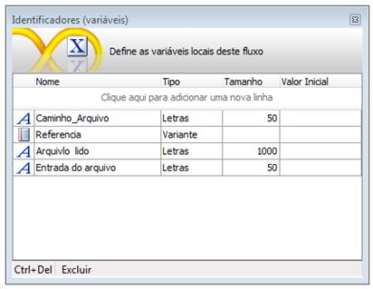
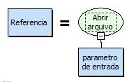
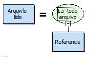
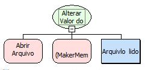
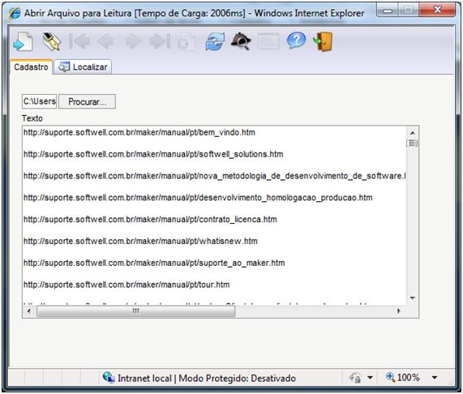

Esse exemplo demonstrará a utilização da função Abrir Arquivo para Leitura.

1. Crie um formulário com as seguintes características:

2. Crie um novo fluxo. Para um melhor entendimento o fluxo ficará da seguinte forma:

3. Adicione um objeto Processamento e no Montador de Expressões selecione a seguinte função: Converter campo do tipo texto para tipo Arquivo:

- 1º parâmetro – Componente do tipo texto que será convertido em um do tipo arquivo
- 2º parâmetro - Quantidade de caracteres (aproximados) que aparecerão. O Firefox 3 necessita dessa propriedade para alterar a largura.

4. Salve o fluxo e associe-o  ao evento  Ao entrar do formulário.
5. Crie um novo fluxo. Para um melhor entendimento o fluxo ficará da seguinte forma:

6. Defina o seguinte parâmetro de entrada:

7. Defina as seguintes variáveis: Caminho_Arquivo, Referencia, Arquivo lido e Entrada do Arquivo:

8. Adicione um novo Processamento e no Montador de Expressões selecione a seguinte função: Abrir arquivo para leitura:

9. Adicione um Processamento e no Montador de Expressões selecione a seguinte função: Ler todo Arquivo:

10. Adicione um Processamento e no Montador de Expressões selecione a seguinte função: Alterar Valor do Componente:

11. Salve o fluxo e associe-o ao evento: Ao clicar do Componente Texto

