Esse exemplo demonstrará o uso da função Remover Arquivo.

1. Crie um formulário sem fonte de dados com o seguinte layout:

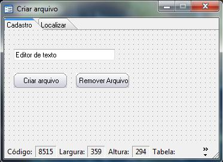

2. Crie um fluxo. Para facilitar o entendimento o fluxo ficará da seguinte forma:

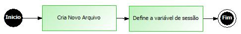

3. Defina o seguinte parâmetro de entrada:

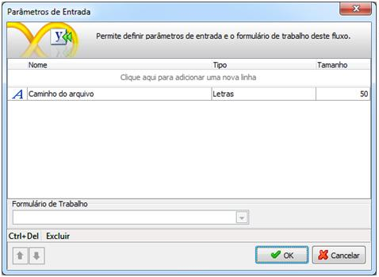

4. Adicione um objeto Processamento e no Montador de Expressões selecione a seguinte função: Cria Novo Arquivo:

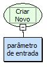

5. Adicione um novo objeto Processamento e no Montador de Expressões selecione a seguinte função: Definir Variável da Sessão.

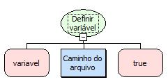

6. Salve o fluxo na camada Servidor, associe-o ao botão Criar arquivo do formulário e defina o seguinte parâmetro de entrada.

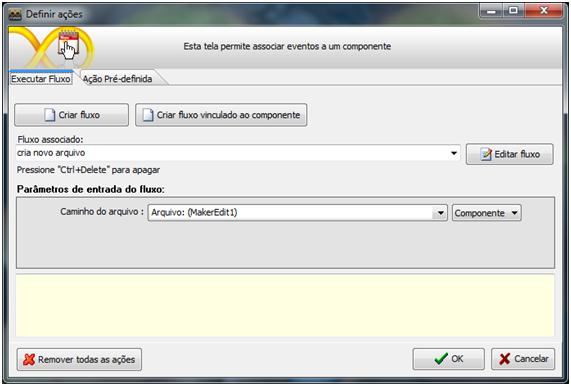

7. Crie um segundo fluxo. Para facilitar o entendimento o fluxo ficará da seguinte forma.

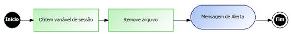

8. Adicione um objeto Processamento e no Montador de Expressões selecione a função: Obter variável da sessão.

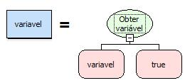

9. Adicione um novo Processamento e no Montador de Expressão selecione a função: Remover Arquivo:

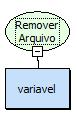

10. Adicione um objeto interação com a seguinte informação: Arquivo Removido com Sucesso!

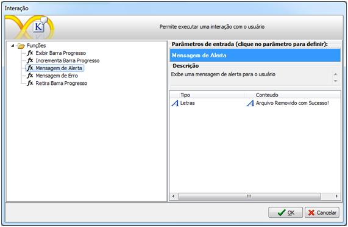

11. Salve o fluxo e associe-o ao botão Remover Arquivo.
12. Salve o formulário e execute-o no webrun:

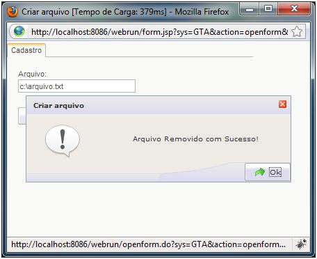
