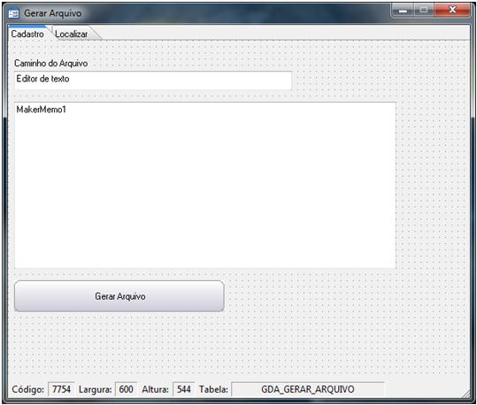
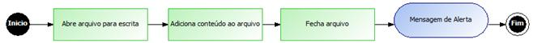
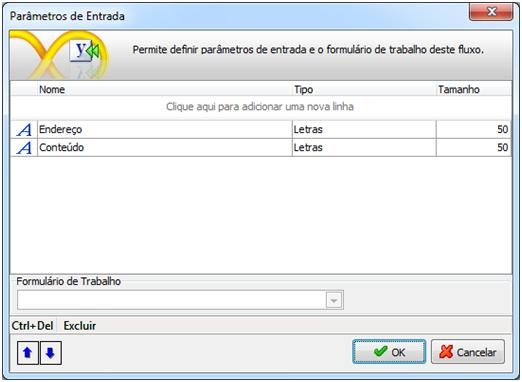
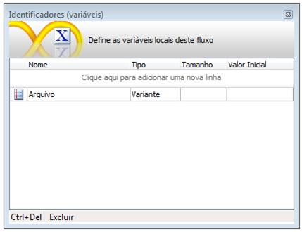
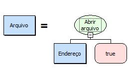
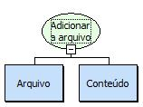
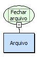
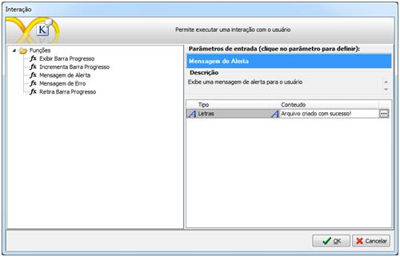
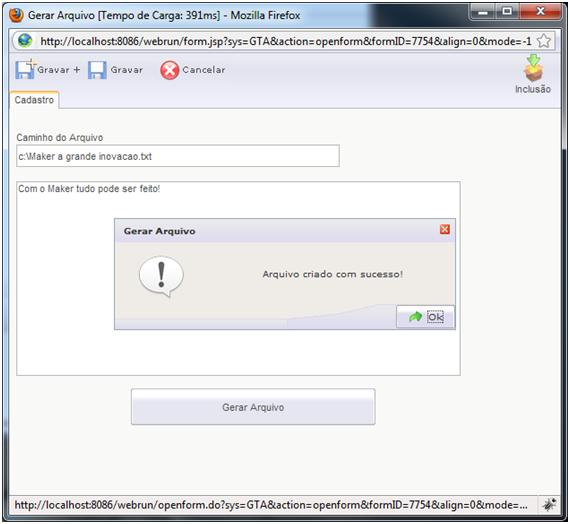

# Utilizando a Função Adicionar a Arquivo

Esse exemplo demonstra a utilização da função adicionar a arquivo.

1. Crie um formulário sem fonte de dados com as seguintes características:

2. Crie um novo fluxo. Para um melhor entendimento o fluxo ficará da seguinte forma:

3. Defina os seguintes parâmetros de entrada:

4. Defina a seguinte variável:

5. Adicione um objeto Pocessamento e no Montador de Expressões selecione a função: Abrir arquivo para escrita:

6. Adicione um objeto to Pocessamento e no Montador de Expressões selecione a função: Adicionar a arquivo:

7. Adicione um objeto to Pocessamento e no Montador de Expressões selecione a função: Fechar arquivo:

8. Adicione um objeto interação com a seguinte informação: Arquivo criado com sucesso!.

9. Salve o fluxo na camada servidor e associe-o ao botão Gerar Arquivo.
10. Execute- o no Webrun:

