Este passo a passo mostra como criar uma função para ser utilizada no Maker.

Será utilizada como exemplo as funções Abrir Formulário numa Moldura (camada **Cliente**) e a função Hipotenusa (camada **Servidor**) para criação do tutorial. Segue o passo a passo:

### Passo a Passo:

1. No ambiente Maker acesse o **menu** Projeto e localize o **submenu** Funções. Será apresentada a tela Funções do fluxo de ações como informa a imagem abaixo:

   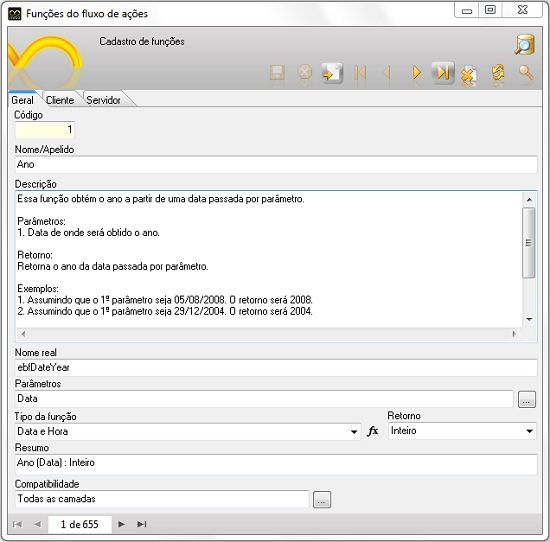
2. Insira um novo registro. Clique em  para apresentar a tela em branco:

   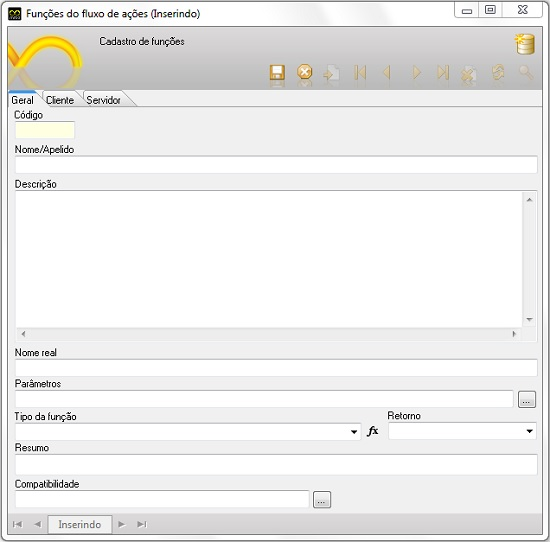
3. **Abas:**
   Note que existem Três abas (Geral, Cliente e Servidor). Na aba Geral será descrito os detalhes da função e nas abas Cliente e Servidor serão desenvolvida em linha de código o comportamento da função**.** Na camada Cliente o código deverá ser em JavaScript e na camada Servidor o código deverá ser em Java**.**

3.1 **Aba Geral**:

- Nome/Apelido - neste campo, deve-se colocar o nome da nova função a ser criada.
- Descrição - neste campo, deve-se colocar a descrição do funcionamento e o que faz a função, pois esta documentação estará disponível na nova lista de funções primitivas do Maker. Moldura de exemplo:

- Descrever a finalidade da função.
- Informar para cada parâmetro o que ele recebe.
- Informar o retorno que a função espera. Caso o fluxo não espera um retorno, deverá ser informado.
- Citar exemplo(os) simulando o funcionamento da função.

- Nome real - neste campo, deve-se colocar o nome da função que deve obedecer às convenções da linguagem java. Exemplo: openFrmModo;
- Parâmetros - neste campo, deve-se colocar os parâmetros que serão passados para função caso ela seja utilizada internamente.
- Tipo de função - neste campo, deve-se informar a categoria da qual a função fará parte. Exemplo: se a função for relacionado com cálculo deverá informar a categoria **Matemática**;
- Retorno - neste campo, deve-se informar o valor a ser retornado, caso a função retorne algum valor.
- Resumo - neste campo, deve-se informar a descrição breve do uso desta função, informando no final do resumo, os tipos de parâmetro que contém na função dentro de parêntese.
- Compatibilidade - neste campo deve-se informar a camada nas quais a função é compatível.

3.2 **Aba Cliente:**

Para demonstração da criação de uma função na camada Cliente, será utilizada como exemplo a função ***(Abrir Formulário numa Moldura - Modo)***.
 **Definição:**A função tem como finalidade abrir um formulário numa moldura no modo edição, navegação ou inserção.

A aba geral, ficará da seguinte forma:

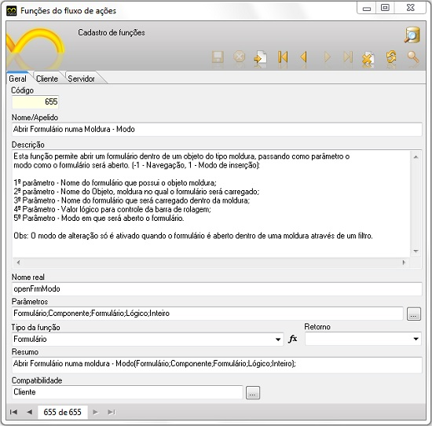

Na aba Cliente, preencha o campo:

JavaScript: neste campo, informe o código-fonte abaixo: /*Componentes e valores passados como parâmetro para função*/

function openFrmModo (formName, componentName, formTarget,scrollbar, mode)

&#123;

var component = controller.getElementById(componentName, formName);

if ((component) && (component instanceof HTMLGroupBox))

&#123;

var oldIframe = component.div.getElementsByTagName("iframe");

/*Verificação e definição da exibição ou não da barra de rolagem*/

var scrolling;

if (scrollbar)

&#123;

scrolling = 'yes';

&#125;

else

&#123;

scrolling = 'no';

&#125;

if (oldIframe.length &gt; 0)

&#123;

if (oldIframe.formOnUnLoadAction)

oldIframe.formOnUnLoadAction();

/*Criação uma variável para guardar o caminho do formulário a ser exibido dentro da moldura, passando também os parâmetros necessários*/

var url = 'form.jsp?sys='+sysCode+'&action=openform&formID='+formTarget

+'&align=0&mode='+mode+'&goto=-1&filter='+(filter?filter:'')+'&scrolling='+scrolling;

if (oldIframe[0].src.substr(oldIframe[0].src.length-url.length) != url)

&#123;

oldIframe[0].src = url

oldIframe[0].style.scrollbars = scrollbar;

alert(mode);

&#125;

&#125;

else

&#123;

ebfFrameOpenURL(formName, componentName,'form.jsp?sys='+sysCode+

'&action=openform&formID='+formTarget+'&align=0&mode='+mode

+'&goto=-1&filter='+(filter?filter:'')+'&scrolling='+scrolling, scrollbar);

alert(mode);

&#125;

&#125;

else

&#123;

throw "O Componente não é do tipo moldura";

&#125;

&#125;

A aba Cliente deverá ficar da seguinte forma:

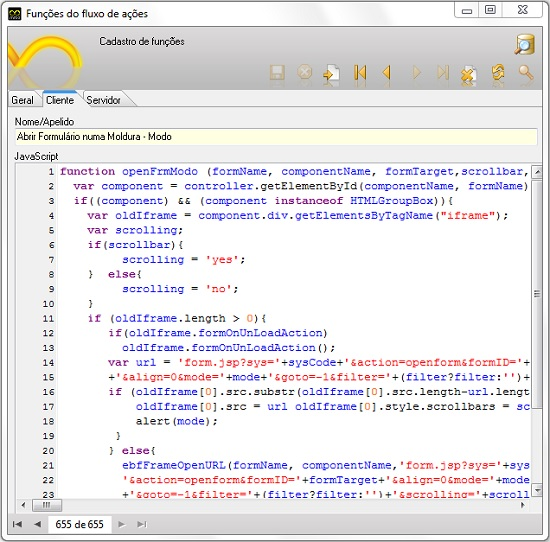

a. Crie um formulário sem fontes de dados, utilizando os componentes Moldura e Botão:

b.
Crie o fluxo para associar ao formulário. Abra o Editor de Fluxos de Ações, adicione um 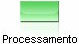 e, no Montador de Expressão, localize a função Abrir Formulário numa moldura - Modo:

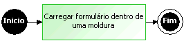

c. No componente Processamento, ficou da seguinte forma:

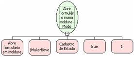

Observação: Salve o fluxo na camada Cliente.

d. Associe o componente Botão do formulário ao Evento "Ao clicar" e teste no Webrun. Após ter clicado no botão, foi aberto o formulário na moldura:

3.3 **Aba Servidor;**

Para demonstração da criação de uma função na camada Servidor, será utilizada como exemplo a função ***(Hipotenusa)***.
 **Definição:**A função tem como finalidade obter o tamanho da hipotenusa de um triângulo retângulo.

A aba geral, ficará da seguinte forma (veja mais informações seção 3.1 - Aba Geral):

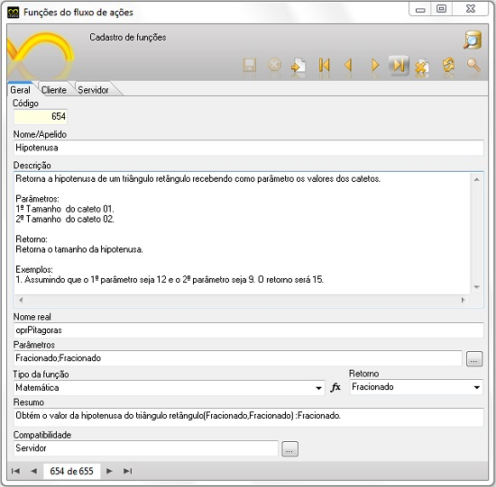

Na aba **Servidor**, preencha o campo:

Java: neste campo, informe o código-fonte abaixo:

protected final Variant oprPitagoras(Variant cateto1, Variant cateto2) throws Exception &#123;

double potencia_cat1 = Math.pow(cateto1.getDouble(),2);
double potencia_cat2 = Math.pow(cateto2.getDouble(),2);

double soma = potencia_cat1 + potencia_cat2;
double result = Math.sqrt(soma);

return VariantPool.get(result);
&#125;

A aba Servidor deverá ficar da seguinte forma:

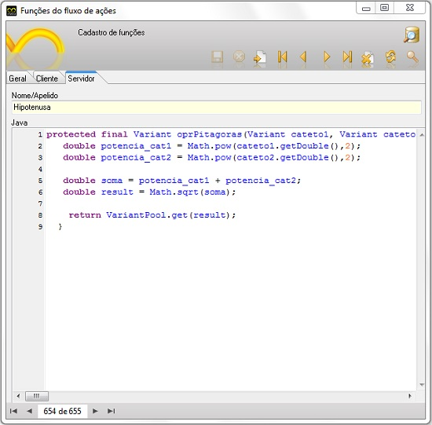

***OBS***: **Devido o Webrun apenas reconhecer variáveis do tipo Variant, torna-se necessário ter conhecimento dos métodos de acesso de cada tipo de dados. Segue a tabela abaixo*.*

| **Tipos** | **Métodos Acessadores** | **Exemplos** |
| --- | --- | --- |
| Inteiro | get / Double(), Long(). | variavel.getDouble(). |
| Letra | get /String(). | variavel.getString(). |
| Fracionado | get / Double(), Long(). | variavel.getDouble(). |
| Data | get / Date () (*Data dentro de Aspas Duplas*). | variavel.getDate(). |
| Boolean | get /Boolean () (*true ou false(Inicial minúscula*). | variavel.getBoolean(). |

a. Crie um formulário com fontes de dados, utilizando os componentes **campo de texto(3)** e **botão(1)**:

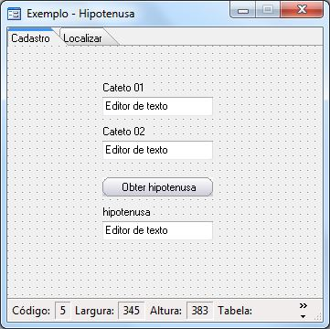

- Primeiro Campo de texto = Irá receber o valor do cateto 1.
- Segundo Campo de texto = Irá receber o valor do cateto 2.
- Terceiro Campo de texto = Irá exibir o valor da hipotenusa.
- Botão = Irá associar com o Fluxo.

b. Crie o fluxo para associar ao formulário. Abra o Editor de Fluxos de Ações, adicione em  dois parâmetros de entrada do tipo Fracionado sendo eles, "cateto 1" e "cateto2" :

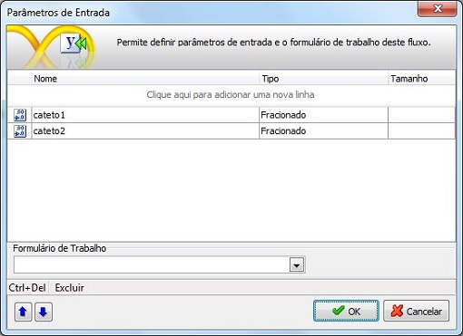

c. Adicione um  e no Montador de Expressão, localize a função Hipotenusa atribuindo no primeiro parâmetro a variável - cateto 1, no segundo parâmetro - cateto 2 e a variável hipotenusa no ***Atribuir o resultado ao identificados***:

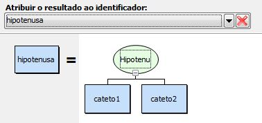

d. Adicione um  e no Montador de Expressão, localize a função ***Alterar valor do componente*** atribuindo no primeiro parâmetro o formulário chamador da função, no segundo parâmetro o componente que será alterado e no terceiro parâmetro a variável hipotenusa:

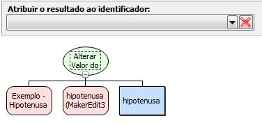

O fluxo ficará da seguinte forma:

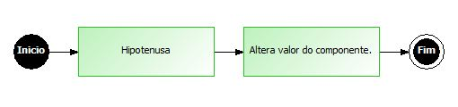
Observação: Salve o fluxo na camada Servidor.

e. Após a criação do Formulário e do Fluxo, deve-se associar o Botão ao fluxo definido o parâmetro de entrada, conforme a imagem abaixo:

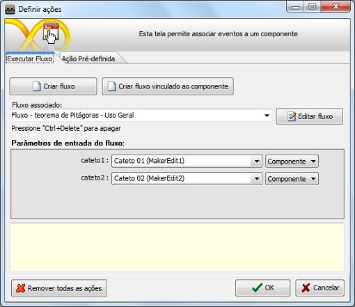
- Ao final do processo de criação da função, clique em  para Salvar a função.
- É necessário que, após a criação de novas funções no Maker, o Webrun seja reiniciado.

Criando Funções - Este vídeo demonstra os passos para a criação de uma nova função para o Editor de fluxos de Ações
