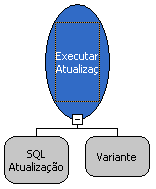
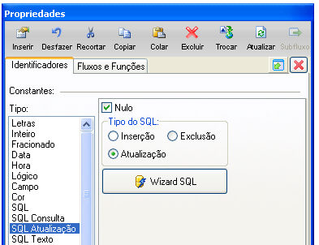
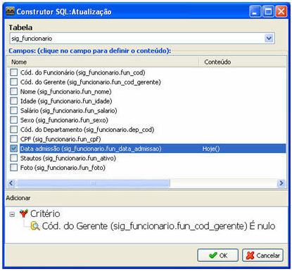
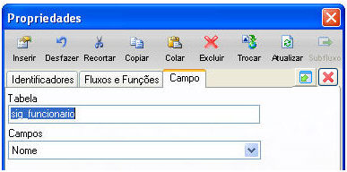

A função Executar Atualização executa um comando SQL de atualização, atuando na camada Banco de Dados.

A função apresenta dois parâmetros:

1º Parâmetro - informar o comando que será aplicado pela função;

2º Parâmetro - é opcional, pode-se escolher a conexão.

Clique no 1º Parâmetro e certifique que a opção Atualização, do campo Tipo do SQL, esteja marcada. Então clique no botão Wizard SQL.

Na tela Construtor SQL: Atualização, selecione a Tabela e os Campos para atualização. Utilize o Montador de Expressões para definir a expressão que será executada.

Existe uma particularidade no comportamento da tela Propriedades para esta função: observe que, além das abas Identificadores e Fluxos e Funções, temos a aba Campo. Nesta aba, é possível selecionar um campo da tabela origem, que será o atualizador, ou seja, em vez de construir uma expressão, o usuário pode optar que o conteúdo tenha origem em um campo da mesma tabela.

