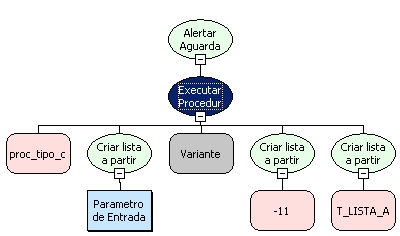

# Utilizando a função Executar Procedure com Retorno Complexo

Para este exemplo utilize os seguintes scripts.

Script 1:

create or replace type t_lista_acoes is table of varchar(50);

Script 2:

create or replace

PROCEDURE proc_tipo_complexo (P_ID IN NUMBER , RETORNO OUT t_lista_acoes) is

BEGIN

    SELECT aco_nome bulk collect into RETORNO from fr_acao where aco_codigo = p_id;

    BEGIN

        for i in RETORNO.first..Retorno.last loop

        dbms_output.put_line('retorno: '||to_char(RETORNO(i)));

        end loop;

    END;

END;

Esta procedure irá obter um número como parâmetro de entrada e realizar uma consulta na tabela fr_acao, filtrando pela coluna aco_codigo.

Crie um fluxo com um parâmetro de entrada(Inteiro) e um processamento, neste processamento utilize a função Executar Procedure com retorno complexo assim como esta montada na figura abaixo.

1. Defina no 1º parâmetro o nome da procedure, neste exemplo: 'proc_tipo_complexo'.
2. No 2º parâmetro é onde se define o parâmetro de entrada, neste exemplo passamos o Parâmetro de Entrada que foi criado no fluxo.
3. No 3º defina a conexão (Caso a conexão seja nula, será usada a conexão principal do sistema)
4. No 4º parâmetro é passada uma lista com os tipos de retorno da função, neste caso passe para lista '-11' referente ao tipo retorno complexo.
5. No 5º parâmetro é passada uma lista com os nomes dos types criados no banco, neste exemplo passe para a lista 'T_LISTA_ACOES'.

Após salvar a regra crie um formulário com um componente caixa de texto e um botão, vincule a regra ao evento do botão e passe como parâmetro de entrada o componente caixa de texto.
