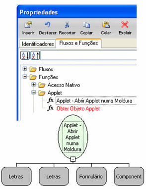
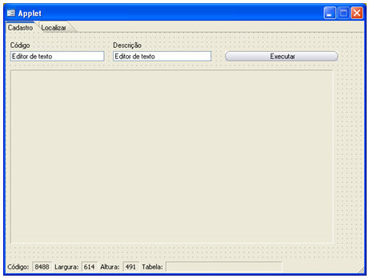
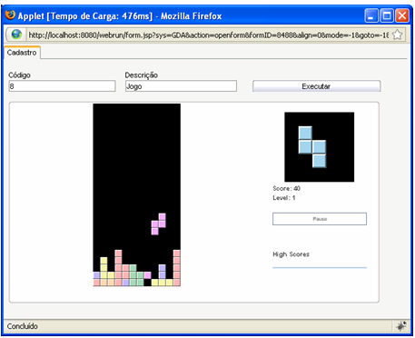
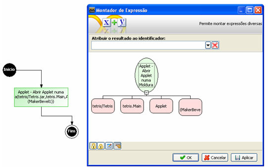

Objetivo

Demonstrar a utilização de funções de Applet no Maker.

Características da Função

- Categoria: Applet;
- Nome da função: Applet - Abrir Applet numa Moldura;
- Descrição da Função:
- - Compatível com a camada Cliente e Servidor;
  - Função que abre um Applet numa moldura;
  - 1º Parâmetro: URL do pacote que contém o Applet;
  - 2º Parâmetro: Nome do Applet;
  - 3º Parâmetro: Formulário que contém o componente do tipo Moldura;
  - 4º Parâmetro: Identificação do componente do tipo Moldura:

Exemplo prático

1. Preparação do Ambiente:

Crie um formulário para a execução do fluxo. No exemplo, implementaremos um botão para executar o fluxo.

2. Neste exemplo, apresentamos um arquivo *.jar, do qual será utilizado um .class. Foi criado um diretório específico para armazenar esses arquivos: C:\Arquivos de programas\Softwell Solutions\Maker 2.7\Webrun 2\tomcat\webapps\webrun\tetris. É importante salientar que a pasta ...\Softwell Solutions\Maker 2.7\Webrun 2\tomcat\webapps\webrun será reestruturada sempre que for atualizado o Webrun. Quando o usuário possuir configurações personalizadas ou utilizar recursos externos (bibliotecas de terceiros, applets), deve-se utilizar a estrutura C:\Arquivos de programas\Softwell Solutions\Maker 2.6\Webrun 2\systems\Maker.Commons, replicando a mesma estrutura de pastas contidas, a partir da pasta C:\Arquivos de programas\Softwell Solutions\Maker 2\Webrun 2\tomcat\webapps\webrun;

3. O fluxo:

Desenvolva um fluxo composto por um objeto Processamento, com a expressão composta pela função Applet - Abrir Applet numa Moldura.

Estruturando a função:

1º Parâmetro - local do arquivo .jar: neste exemplo tetris/Tetris.jar;

2º Parâmetro - nome do Applet: arquivo de classe Java, (neste exemplo) tetris.Main;

3º Parâmetro - identificação do formulário que contém o componente Applet

4º Parâmetro - nome do componente Moldura.

Salve o fluxo e atribua ao evento Ao Clicar do botão que adicionou no formulário.

Adicionando Applet numa Moldura - Esse exemplo demonstra como abrir um Applet no componente Moldura
