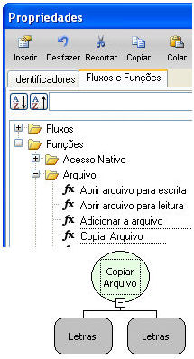
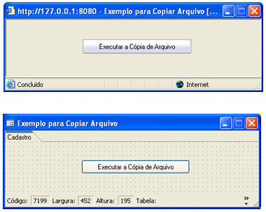
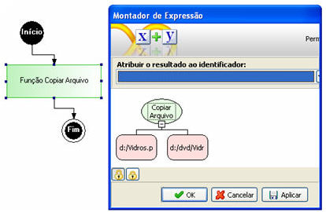

Objetivo

Demonstrar a utilização da função Copiar Arquivo.

Características da Função

- Categoria: Arquivo
- Nome da função: Copiar Arquivo
- Descrição da Função:
- Compatível com a camada Servidor;

1º Parâmetro - Caminho de origem e identificação do arquivo;

2º Parâmetro - Caminho de destino e identificação do arquivo.

Ambiente

- Versão Maker: 2.3.4.494;
- Versão Webrun:20080410;
- SGDB: homologados.

Exemplo prático

1. Preparação do Ambiente:

Crie um formulário para a execução do fluxo. No exemplo, implementaremos um botão para executar o fluxo.

2. O fluxo:

Desenvolva um fluxo composto por um objeto Processamento, com a expressão composta pela função Copiar Arquivo.

Estruturando a função:

1º Parâmetro - local de origem e nome do arquivo: neste exemplo d:/Vidros.ppt;

2º Parâmetro - local de destino e nome do arquivo: neste exemplo d:/dvd/Vidros.ppt.

Salve o fluxo e atribua ao evento Ao Clicar do botão que adicionou no formulário.
