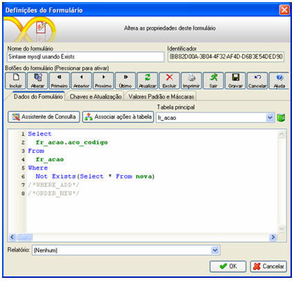
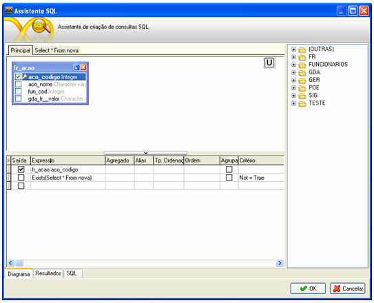

Abaixo, segue um exemplo ilustrativo da sintaxe da função EXIST na constituição da consulta de um formulário:

Tela Definições de Formulários, acionada a partir do botão Propriedades da paleta Objetos:

Tela Assistente SQL, acionada a partir do botão :

