Neste tópico, será mostrada utilização de algumas funções XML. O exemplo criado apresentará o Nome, a Idade e o Endereço do Empregado.

Para facilitar o entendimento, o fluxo ficará da seguinte forma:

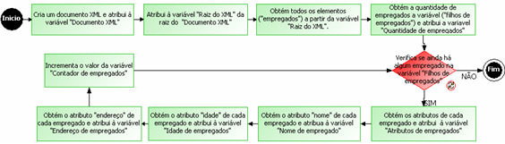

Siga os passos:

1º Passo: Criar o fluxo. Após a abertura da tela [Editor de Fluxos e Ações](../../maker_2/fluxos_e_acoes/editor_de_fluxo_de_acoes), apresentará a tela Identificadores (variáveis) para criação das variáveis:

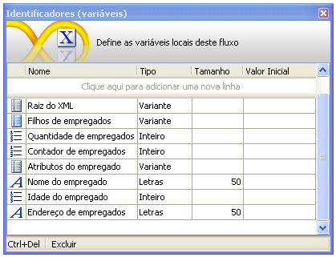

2º Passo: Insira 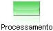 para criação do documento XML. Use a função Abrir XML e atribua o resultado à variável Documento XML:

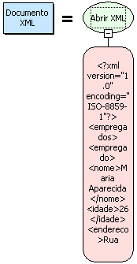

No parâmetro da função, foi adicionado o script abaixo:

&lt;?xml version="1.0" encoding="ISO-8859-1"?&gt;

&lt;empregados&gt;

&lt;empregado&gt;

&lt;nome&gt;Maria Aparecida&lt;/nome&gt;

|&lt;idade&gt;26&lt;/idade&gt;

&lt;endereco&gt;Rua Terra, 13&lt;/endereco&gt;

&lt;/empregado&gt;

&lt;empregado&gt;

&lt;nome&gt;Eugenio Mazzini&lt;/nome&gt;

&lt;idade&gt;42&lt;/idade&gt;

&lt;endereco&gt;Rua La Paz, 516&lt;/endereco&gt;

&lt;/empregado&gt;

&lt;/empregados&gt;

3º Passo: Insira  para obter o documento XML. Use a função Obter Raiz e atribua o resultado à variável Raiz do XML:

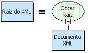

4º Passo: Insira  para obter o filho de um determinado elemento XML informado. Nesse caso, é "empregado". Use a função Filho de um Elemento XML e atribua o resultado à variável Filhos de Empregados:

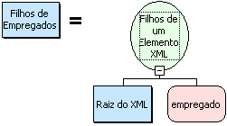

5º Passo: Insira  para obter a quantidade de filhos do elemento "empregado". Use a função Tamanho da Lista e atribua o resultado à variável Quantidade de Empregados:

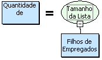

6º passo: Insira  para verificar se o contador é menor ou igual à quantidade de empregados. Use a função Menor ou igual:

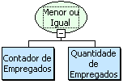

7º passo: Insira  para obter o objeto da lista. Use a função Obter Objeto da Lista e atribua o resultado à variável Atributos do Empregado:

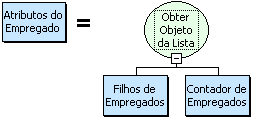

8º passo: Insira  para obter o filho do elemento "nome". Use a função Obter Filho de Elemento e insira acima outra função, Obter o valor de um Elemento XML e atribua o resultado à variável Nome do Empregado:

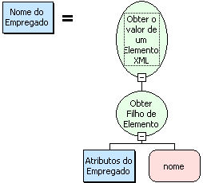

9º passo: Insira  para obter o filho do elemento "idade". Use a função Obter Filho de Elemento e insira acima outra função, Obter o valor de um Elemento XMLe atribua o resultado à variável Idade do Empregado:

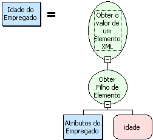

10º passo: Insira  para obter o filho do elemento "endereco". Use a função Obter Filho de Elemento e insira acima outra função, Obter o valor de um Elemento XMLe atribua o resultado à variável Endereço do Empregado:

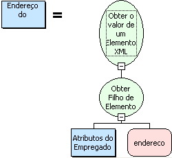

11º passo: Insira  para exibir na tela o Nome, a Idade e o Endereço do Empregado. Use a função Concatenação, Quebra de Linha e Para Letras:

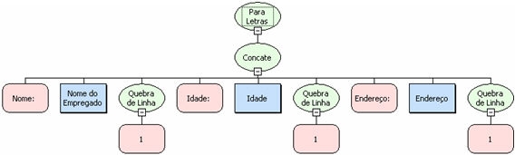

12º passo: Insira  para somar mais "1" à variável "contador de empregados". Use a função Soma e atribua o resultado à variável Contador de Empregados:

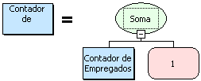

Por fim, faça ligação desse último  para o componente  construindo um laço de repetição. Salve o fluxo na camada Servidor.

Após ter concluído o fluxo, é necessário criar um formulário sem fonte de dados com um botão:

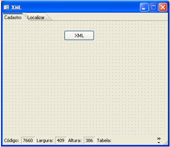

Observação: Associe o botão ao fluxo.

Para testar o funcionamento do fluxo, acesse o Webrun, localize o formulário criado e clique no botão XML:

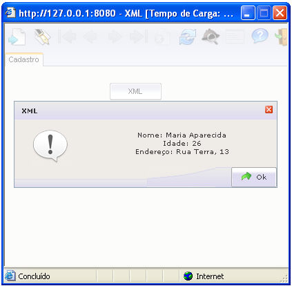

Utilizando função XML - este exemplo demonstra a utilização de funções da Categoria XML.
