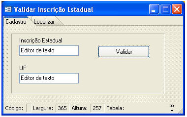
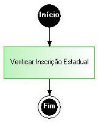
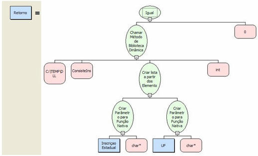
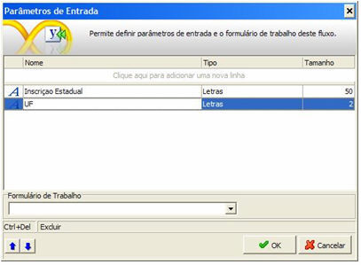
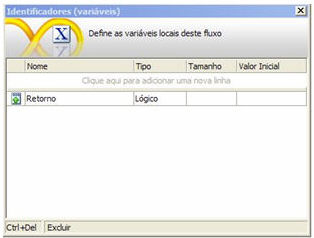
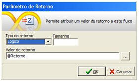
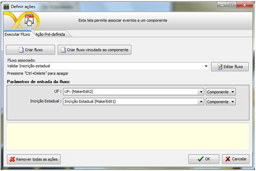
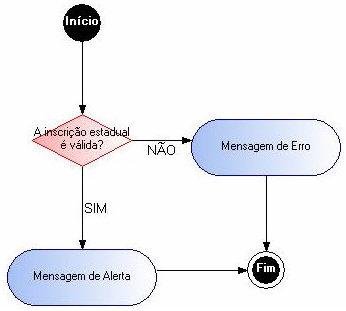
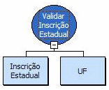

Objetivo

Demonstrar a utilização de funções nativas (bibliotecas de vínculo dinâmico no Maker)

Funções Utilizadas

- Criar Parâmetro para Função Nativa
- Chamar Método de Biblioteca Dinâmica
- Criar lista a partir dos Elementos
- Igual

Metodologia

Será utilizada a biblioteca de validação de Inscrições Estaduais para validar uma inscrição estadual.

1. Crie o formulário para inserir os dados de teste.

2. Crie o fluxo de validação:

O processamento Verificar Inscrição Estadual usa a função Chamar Método de Biblioteca Dinâmica. Observe que os parâmetros para a função nativa são criados como uma lista na qual cada elemento corresponde a um parâmetro para a função nativa. O parâmetro é criado usando a função Criar Parâmetro para Função Nativa, especificando-se o tipo nativo do parâmetro.

- Variável do Fluxo de Validação

- Retorno do Fluxo de validação

- Ação do botão validar

- Fluxo do botão validar

- Decisão: A inscrição estadual é válida?

Conclusão

O tutorial demonstra a facilidade do uso de bibliotecas dinâmicas no Maker, sem a necessidade de elementos adicionais, tornando possível qualquer implementação que dependa dessas bibliotecas.

Observação: Ao ser utilizada uma dll que não contenha parâmetro é necessário utilizar uma lista passando o valor "nulo".
