Objetos COM são usados para fazer uma chamada diretamente com o usuário SYSTEM através do CLSID do programa. A API do Maker possui funções específicas para uso destes objetos. O primeiro passo para utilizar estas funções é encontrar o CLSID do programa, este CLSID pode ser obtido através do registro do Windows.

Neste exemplo utilizaremos o aplicativo Excel, o qual irá criar um arquivo e adicionará uma planilha ao mesmo. Para seguir essa linha de raciocínio, siga os passos abaixo:

Para um melhor entendimento o fluxo ficará da seguinte forma:

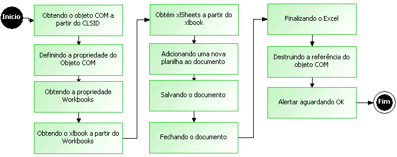

1. No 1º processamento deverá ser utilizada a função Criar Objeto COM a qual tem como parâmetro o CLSID do programa. Esta função retornará a referência do objeto Excel que será utilizada para executar os métodos.

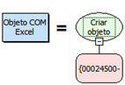

2. No 2º processamento defina a propriedade visible do objeto utilizando a função Definir propriedade de um objeto COM.

Observação: Quem está executando os métodos é o usuário do servidor de aplicações (geralmente usuário SYSTEM, portanto o aplicativo não fica visível e sim em background).

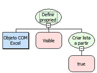

3. No 3º processamento obtenha a propriedade Workbooks utilizando a função Obter propriedade de um objeto COM.

O objeto Workbook representa uma pasta de trabalho do Microsoft Excel. O objeto Workbook é um membro da coleção Workbooks, esta coleção contém todos os objetos Workbook atualmente abertos no Microsoft Excel.

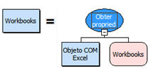

4. O próximo passo é obter a propriedade add do Workbooks a qual retorna uma variável do tipo variante. Armazene a referência na variável xlbook.

O xlbook é a referência do arquivo em uso.

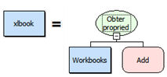

5. O próximo passo é obter a propriedade do xlbook chamada worksheet.

O objeto Worksheet representa uma planilha, este objeto é um membro da coleção Worksheets. A coleção Worksheets contém todos os objetos Worksheet em uma pasta de trabalho.

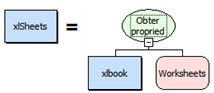

6. Utilize a função Executar Método de um objeto COM para adicionar uma planilha ao documento.

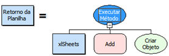

7. Salve o documento e passe como parâmetros a referência do arquivo em execução, o nome do método SaveAs e uma lista contendo o nome do arquivo com sua extensão.

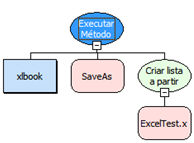

Por padrão o documento é salvo em:

\WINDOWS\system32\config\systemprofile\Meus documentos\

8. Feche o arquivo.

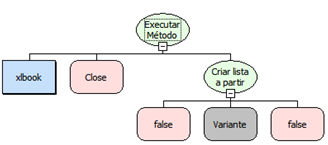

9. Finalize o Excel.

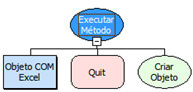

10. Para finalizar, destrua a referência do objeto COM criado.

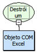

11. Salve o fluxo e associe-o a um botão, que ao executado criará um arquivo Excel com 4 planilhas.
