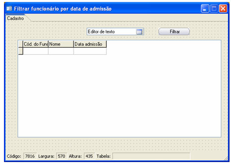
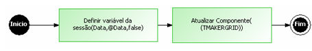
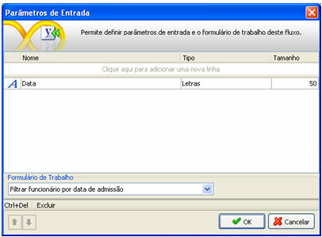
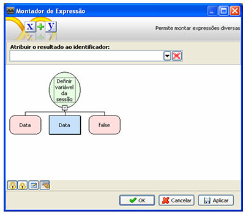
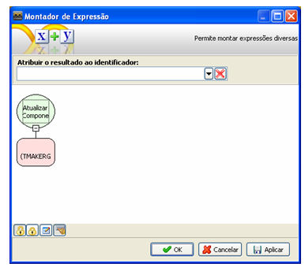
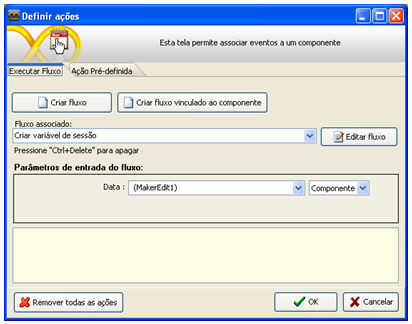
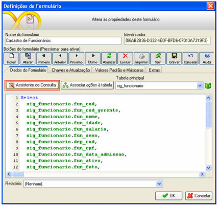
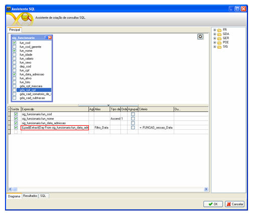
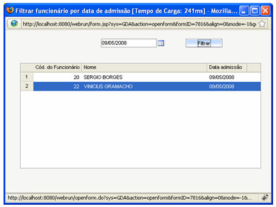

Esse exemplo demonstra de maneira prática como filtrar um campo do tipo data por uma variável de sessão.

1. Crie um formulário com as seguintes características:

2. Criação do fluxo:

Para facilitar o raciocínio o fluxo ficará da seguinte forma:

1. Defina o seguinte parâmetro de entrada

2. Adicione um processamento e utilize a seguinte função: Definir variável de sessão.

3. Adicione um processamento e utilize a função: Atualizar Componente.

4. Associe o fluxo ao botão Filtrar do formulário e em Parâmetros de entrada do fluxo, selecione o componente MakerEdit1.

3. Definindo a consulta SQL.

1. Clique sobre o componente Grade do formulário e selecione Definições e em seguida Assistente de Consulta.

A consulta ficará da seguinte forma:

2. (Lpad(Extract(Day From sig_funcionario.fun_data_admissao), 2, '0') || '/' || Lpad(Extract(Month From sig_funcionario.fun_data_admissao), 2, '0') || '/' || Extract(Year From sig_funcionario.fun_data_admissao)). Conteúdo do campo selecionado em vermelho.

Observação: O select irá variar para cada tipo de banco utilizado. No exemplo o banco utilizado é o Postgres.

4. Salve o formulário e execute-o no Webrun.

