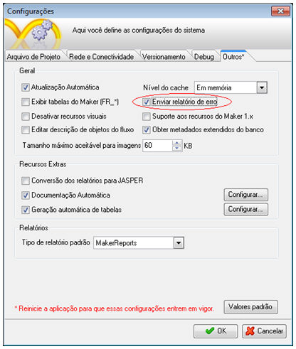
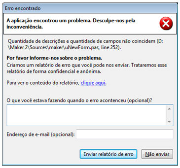
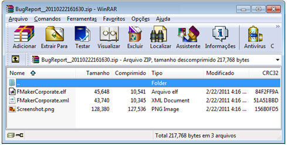

Durante o desenvolvimento de um projeto, não é comum que um erro inesperado seja apresentado pela ferramenta Maker ao desenvolvedor. Situações como esta podem ser apresentadas em casos onde há problemas de ambiente, muitas vezes ocasionados por instalações/desinstalações de softwares ou até mesmo por alguma instabilidade do Maker.

Ao ocorrer situações como a descrita acima, o diagnóstico muitas vezes se torna difícil, pois cada usuário tem uma forma específica de utilização do computador e acaba fazendo modificações que podem influenciar nas dependências do Maker. Para facilitar o diagnóstico de erros incomuns apresentados, existe uma funcionalidade do Maker chamada Enviar Relatório de Erro.

Para ativar esta funcionalidade, vá em Menu -> Projeto -> Configurações (ou tecle F6). Com a tela de configurações aberta, vá a aba Outros* e marque a opção Enviar Relatório de Erro, clique em OK, Salve o Projeto e reinicie a aplicação.

Com esta funcionalidade ativa, toda vez que um erro inesperado ocorrer, clique na opção Enviar Relatório de Erros" e o Maker automaticamente criará um arquivo com extensão .ZIP na pasta C:\Documents and Settings\&lt;nome do usuário&gt;\Configurações locais\Dados de aplicativos\Softwell Solutions\Maker 2.

O nome do arquivo segue o padrão BugReport__AAAAMMDDHHMMSS, isso identifica o dia e hora do arquivo gerado. Dentro do arquivo gerado há três arquivos: FMakerCorporate.elf, FMakerCorporate.xml e ScreenShot.png. Os dois primeiros contêm a pilha de chamadas realizadas pelo Maker e o ponto que ocorreu o erro, o terceiro contém um print da tela de erro apresentada.

Entre em contato com o Suporte e encaminhe o arquivo para análise.
